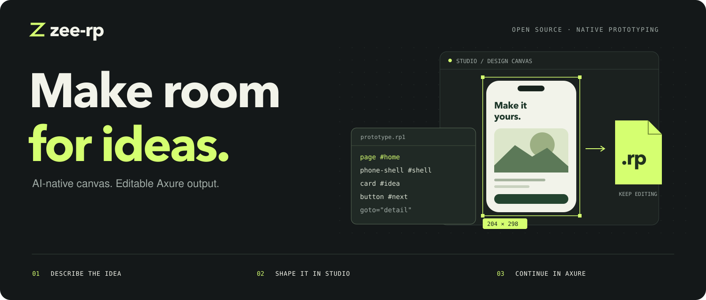
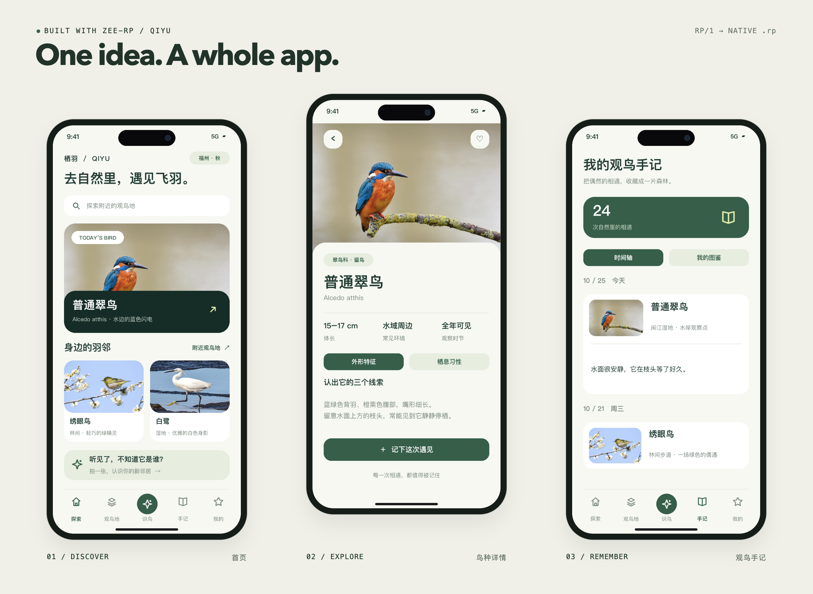
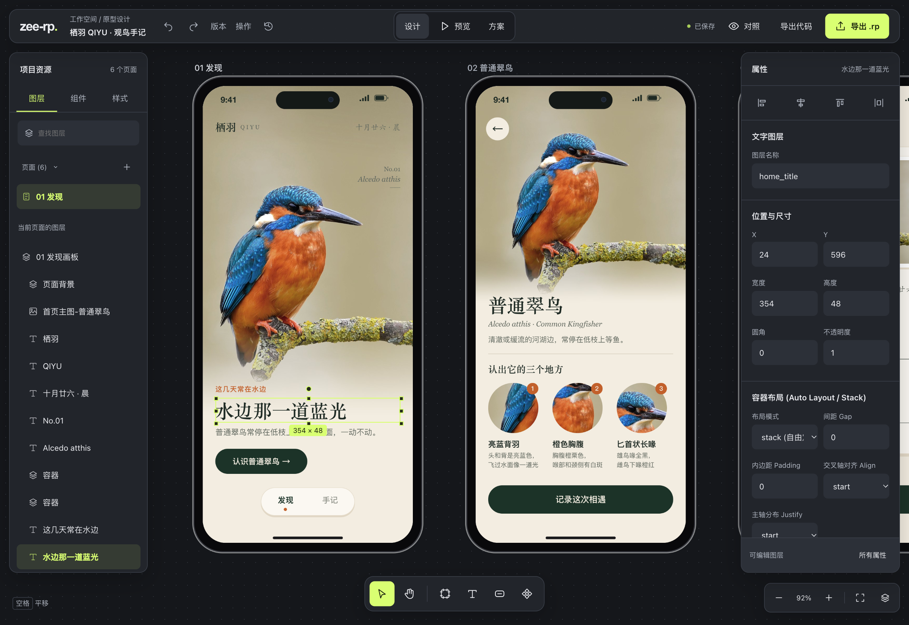

<div align="center">



# Give AI room to design.<br>Bring the work into Axure.

**Author in RP/1. Explore with your agent. Refine together. Keep an editable `.rp`.**

[Get started](#quickstart)　·　[Studio](#studio)　·　[RP/1](#rp1)　·　[Web Workbench](https://lilzeecn.github.io/zee-rp/)　·　[简体中文](README.md)

[](LICENSE) [](https://github.com/LilZeeCN/zee-rp/actions) [](https://lilzeecn.github.io/zee-rp/)

</div>

<br>



<p align="center"><b>QIYU</b>　Discover a bird. Get to know it. Keep the encounter.</p>
<p align="center"><sub>Nine-page native prototype · Separate text, buttons and inputs · Demo identification and statistics · <a href="assets/readme/README.md">Case notes and credits</a></sub></p>

<br>

<a id="studio"></a>

## 01　Make room for refinement.

Studio is a free canvas for people and agents. Let AI build the first draft, then select, edit text and adjust layouts directly. Hand a small part back to your agent and explore another direction.



**AI drafts.** Author through RP/1 or commands; query layers and make targeted changes.<br>
**You refine.** Double-click text, Shift-drag a marquee, hold Option / Alt to measure, undo and redo.<br>
**Verify together.** Inspect real screenshots and exercise interactions before delivery.

[Studio workflow](docs/studio-design-workflow.md)　↗　[AI authoring](docs/studio-ai-authoring.md)

<br>

<a id="rp1"></a>

## 02　Give design intent a source file.

**RP/1** keeps pages, layout, components, variables and interactions together. Agents can target specific changes while the design keeps its structure, revision identity and a place to continue.

```text
rp/1 target=9 name="Next encounter" domain=mobile theme=mobile-hifi

page #home name="Discover" device=iphone-17-pro
  phone-shell #shell title="Meet your feathered neighbors." gap=16
    card #bird [fillxhug] title="A kingfisher by the water" body="Start your field notes with a flash of blue." actionText="Record this encounter" goto="notes"

page #notes name="Journal" device=iphone-17-pro
  phone-shell #shell title="My first field note" gap=16
    input #note [fillx44] value="I spotted it by the water today."
    button #back [fillx44] "Back to discovery" goto="home"
```

Grow a page into a complete flow, revise with `revise_prototype`, and merge supported native edits back into source.

[RP/1 reference](references/rp-language.md)　↗　[Examples](examples/authoring/mobile-cards.rp1)　↗　[Native roundtrip](docs/studio-native-roundtrip.md)

<br>

## 03　Keep the design in your hands.

Generate a native **`.rp`** and continue editing supported text, controls and layouts in Axure. Deliver pages, variables, panels and navigation together, alongside source, previews and verification reports.

| Continue in | What stays with you |
| :--- | :--- |
| **Studio** | A shared design document, transactions, atomic `fix_plan(apply:true)` healing and undo history |
| **Axure** | Open native `.rp`, decompile existing `.rp` into Studio, or export back to `.rp1` via `studio_export(format:"rp1")` |
| **Binary Toolchain** | `diff-rp` (GUID semantic diff), `repair-rp` (corrupt salvage), `downgrade-rp` (RP11→RP9), `build-library` (`.rplib`), [Live Web Workbench](https://lilzeecn.github.io/zee-rp/) ([offline standalone HTML](tools/rp-inspector/index.html)), [binary format spec](docs/rp-format-spec.md), and `native-check --compile` |
| **The browser** | Drag/swipe/timer previews; run cross-platform Chrome verification without Axure via `verify_prototype(engine:"studio-html")` |
| **HTML / URL / Image** | Pass local `.html`, `http(s)://` URLs or UI screenshots to `studio_open_project` / `generate_prototype` / `generate_from_image` |

[Native export and sync](docs/studio-native-roundtrip.md)　↗　[HTML / URL import](references/html-workflow.md)　↗　[Code export](docs/studio-code-export.md)　↗　[Blind test report](docs/blind-test-t01-20261126.md)　↗　[Gaps ledger](docs/gaps.md)　↗　[40-second workflow animation](https://github.com/LilZeeCN/zee-rp/releases/download/v0.2.1/zee-rp-zhixu-1080p60.mp4)

<br>

<a id="quickstart"></a>

## Get started

Install **Node.js 18+** and **Python 3.10+**. Blank projects and basic RP/1 layouts can be generated offline.

### One-command install (straight from GitHub)

```sh
npx -y github:LilZeeCN/zee-rp doctor                 # no clone needed: checks Node / Python / Chrome / template
npm i -g github:LilZeeCN/zee-rp                      # or install the CLI, then run zee-rp
zee-rp doctor                                        # check Node / Python / Chrome / template readiness
```

Install the Python dependencies once: `python3 -m pip install pillow numpy jsonschema` (screenshot reconstruction also needs SciPy). Pin a version with `github:LilZeeCN/zee-rp#v0.4.0`.

### macOS

```sh
git clone https://github.com/LilZeeCN/zee-rp.git
cd zee-rp
python3 -m venv .venv
source .venv/bin/activate
python -m pip install -r requirements.txt
npm ci
npm run doctor   # 3-second check for Node, Python, Chrome and RP9 template readiness
```

### Windows

Native `.rp` reading, writing and generation run on Windows (Node 18+ / Python 3.10+).

Use Node.js 24 and Python 3.12 to match desktop CI. Install from PowerShell.

```powershell
git clone https://github.com/LilZeeCN/zee-rp.git
cd zee-rp
py -3.12 -m venv .venv
$env:ZEE_PYTHON = (Resolve-Path .\.venv\Scripts\python.exe).Path
& $env:ZEE_PYTHON -m pip install pillow numpy jsonschema
npm.cmd ci
```

- The generator can synthesize blank RP9 and RP11 projects. Set `AXURE_BLANK_TEMPLATE_RP9` or `AXURE_BLANK_TEMPLATE_RP11` to use your own template.
- Axure is auto-detected in common install directories and drive-root portable installs (`C:\AxureRP9.exe`, `D:\AxureRP9.exe`). Override with `AXURE_APP_RP9`; point at `DefaultSettings` with `AXURE_INSTALL_ROOT_RP9` (install root) or `AXURE_DEFAULT_SETTINGS_RP9` (direct path).
- Multi-path environment variables use `;` on Windows (`AXURE_PROTECTED_PATHS`, `AXURE_WRITE_ROOT`).
- RP/1 uses the native backend by default. Pass `--backend native` for older specs with `build-rp` or `generate`. The GUI backend, macOS menu automation and `tools/rp9_place.py` are macOS-only. `axvg paste` writes the payload to the Windows clipboard. Press Ctrl+V in Axure.
- Screenshot reconstruction needs SciPy. Windows supports shape detection and requires you to supply text separately. OCR uses Apple Vision on macOS.
- Windows and macOS CI cover RP/1 file parsing, compilation and output paths. Run `npm.cmd run test:mcp-generate` with your local Axure template to verify full MCP generation on Windows. `test:backend` also needs a compatible `Training/RP9 Tour.rp`. When the built-in tour has no `Discount Panel`, generation uses the first unnamed panel as a blank shell. To copy existing state content when several unnamed panels are available, specify a named panel using `AXURE_PANEL_TEMPLATE` and `AXURE_PANEL_TEMPLATE_NAME`.

### Generate your first RP9 prototype

Run the generator directly. It builds blank projects and basic RP/1 layouts offline. Builds that clone Axure library controls or panel fixtures still need those local assets.

Synthesized projects include `Heading 1–6`, `Paragraph`, `Form Hint`, and `Form Disabled` in the Axure widget style list. Set `AXURE_BLANK_TEMPLATE_RP9` or `AXURE_BLANK_TEMPLATE_RP11` to inherit another project's styles or its Word specification configuration.

```sh
node scripts/proto.mjs generate --spec examples/authoring/mobile-cards.rp1 --out-dir output/mobile-cards --out-rp output/mobile-cards.rp --backend native
```

Open `output/mobile-cards.rp` in Axure RP9 to edit it.

### Discover and reuse an Axure library

```sh
zee-rp index-library /path/to/components.rplib
zee-rp index-library /path/to/components.rplib --folder 'Forms' --limit 10 --json
zee-rp clone-library-widget /path/to/components.rplib /path/to/project.rp /path/to/result.rp 'Button' 'Page 1' 'Primary action'
```

The default index is a folder and count summary capped at 4 KB. Use `--folder` to select a folder path, `--limit` to cap the number of listed items, and `--json` to read item record numbers, widget IDs, classes, dimensions, and current text. Pass `--json` on its own for a full dump. Select a duplicate item with `'#<record>'` or pick a widget within an item with `--source-widget 'name'` or `--source-widget '#<id>'`. Use `clone-library-page-content` for complete groups and dynamic panel states. Agents can call both commands through `rp_command`.

<details>
<summary><b>Connect your MCP client</b> · Expand configuration</summary>

Without cloning, let npx fetch the package from GitHub (`zee-rp mcp` and `zee-rp-mcp` are equivalent):

```json
{
  "mcpServers": {
    "zee-rp": {
      "command": "npx",
      "args": ["-y", "github:LilZeeCN/zee-rp", "mcp"]
    }
  }
}
```

When running from source, replace the absolute paths with your installation and Python environment:

```json
{
  "mcpServers": {
    "zee-rp": {
      "command": "node",
      "args": ["/absolute/path/zee-rp/bin/mcp.mjs"],
      "env": {
        "ZEE_PYTHON": "/absolute/path/zee-rp/.venv/bin/python"
      }
    }
  }
}
```

The example uses macOS paths. On Windows, use paths such as `C:/work/zee-rp/bin/mcp.mjs`, `C:/work/zee-rp/.venv/Scripts/python.exe` in the corresponding fields. Use an absolute Node path in `command` if needed. Reconnect MCP after updates.

</details>

Call `studio_open_project` and open the returned `url`:

```json
{ "projectDir": "/absolute/path/my-first-prototype" }
```

Then give your agent a brief:

> Design a birdwatching app with discovery, species details and a journal. Start in the canvas, verify navigation and saved observations, then export an editable `.rp`.

<details>
<summary><b>Agent entry points and scope</b></summary>

Agents start with `studio_describe({"topic":"workflow"})`. Use `sourcePath` in `studio_open_project` to import RP/1, and `generate_prototype` for full native generation. Local authoring and full compilation have separately documented scopes.

Native generation targets RP9; file tools handle RP9 / RP11 by version. Host evidence mainly covers macOS + Axure RP9. Some effects use embedded raster assets; fonts and previews depend on the host. Fractional-zoom sharpness and very large single boards remain bounded.

Structure, browser behavior and Axure save/reopen are separate checks. [Capabilities](references/capabilities.md) · [Acceptance layers](docs/studio-acceptance.md) · [Troubleshooting](references/troubleshooting.md)

</details>

<br>

---

[Agent Skill](SKILL.md)　/　[Contributing](CONTRIBUTING.md)　/　[Changelog](CHANGELOG.md)　/　[MIT License](LICENSE)

<sub>Independently built by LilZee · Unaffiliated with Axure · Third-party photography retains its own credits and licenses</sub>
