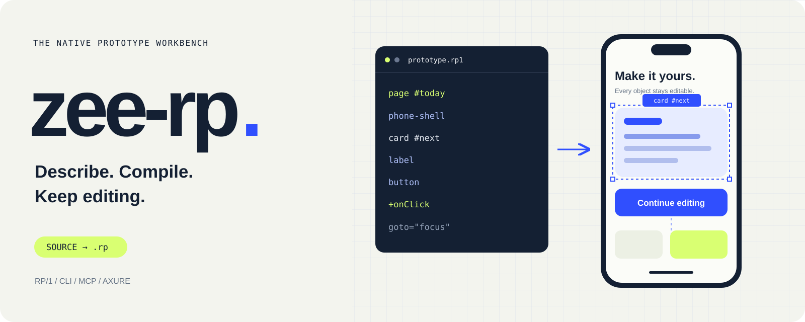
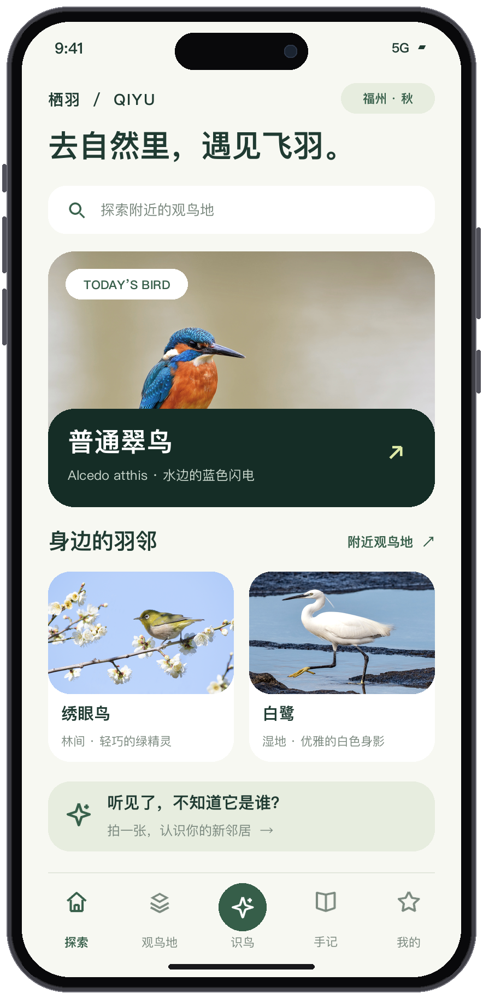
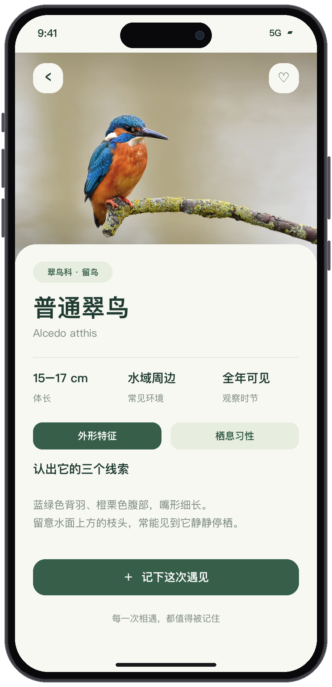
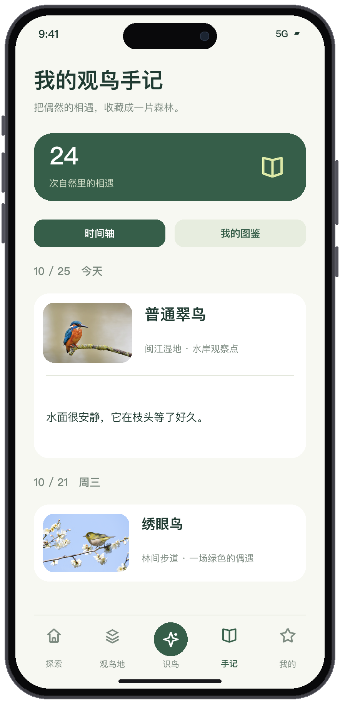
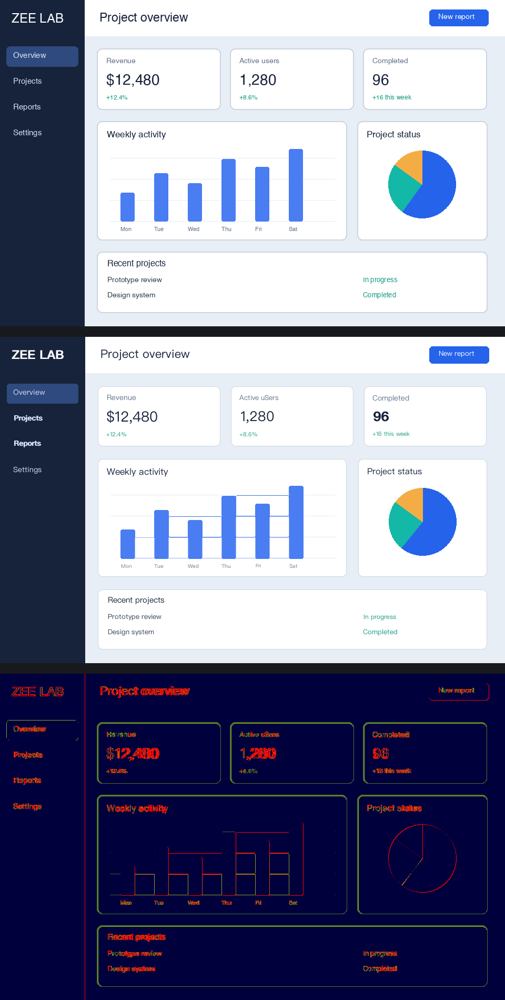

<div align="center">



# Let AI build a prototype you can keep editing in Axure.

From a brief or screenshot to a native **`.rp`** with pages, variables and interactions.<br>
Author in **RP/1**, generate through **MCP / CLI**, continue in **Axure**.

[](LICENSE)
[](https://github.com/LilZeeCN/zee-rp/releases)
[](https://github.com/LilZeeCN/zee-rp/actions)

[See a prototype](#a-complete-app-first) · [Get started](#connect-your-agent) · [RP/1](#a-design-with-source-code) · [Scope](#verify-each-step-of-the-delivery) · [简体中文](README.md)

</div>

## A complete app, first

> “Build a good-looking birdwatching app with an iPhone 17 Pro frame. You decide the design.”

**QIYU** uses forest green, warm white and bird photography across nine pages: discovery, a sample-photo identification flow, species details, birding locations and a personal journal. Enter an observation, save it, revisit its text, favorite a bird and switch between timeline and collection views.

<table>
<tr>
<td width="33%"></td>
<td width="33%"></td>
<td width="33%"></td>
</tr>
<tr><td align="center">Discover</td><td align="center">Get to know a bird</td><td align="center">Keep the encounter</td></tr>
</table>

Text, cards, buttons, inputs and the schematic map are separate objects. Photos are embedded images. Identification, routes and statistics use demo data. [Image credits and case notes](assets/readme/README.md).

### A 40-second look at the workflow

https://github.com/user-attachments/assets/39c37462-3956-48b8-b495-fe90d2ab9431

The Zhixu study app illustrates the path from a brief to an editable prototype. The film is a workflow animation based on the case specification. [Download 1080p / 60fps](https://github.com/LilZeeCN/zee-rp/releases/download/v0.2.1/zee-rp-zhixu-1080p60.mp4) · [Production notes](assets/promo/README.md).

## A design with source code

**RP/1** keeps pages, layout, data and events in one source file. Generate a native project, revise its source, or make supported native edits in Axure and merge them back.

```text
rp/1 target=9 name="Next encounter" domain=mobile theme=mobile-hifi

page #home name="Discover" device=iphone-17-pro
  phone-shell #shell title="Meet your feathered neighbors." gap=16
    card #bird [fillxhug] title="A kingfisher by the water" body="Start your field notes with a flash of blue." actionText="Record this encounter" goto="notes"

page #notes name="Journal" device=iphone-17-pro
  phone-shell #shell title="My first field note" gap=16
    input #note [fillx44] value="I spotted it by the water today."
    button #back [fillx44] "Back to discovery" goto="home"
```

Save as `birding.rp1`, then call MCP `generate_prototype`:

```json
{
  "source": "/absolute/path/birding.rp1",
  "output": "/absolute/path/birding.rp"
}
```

The output includes the native file, source baseline, page previews, state sheets and verification reports. `[fillxhug]` fills the available width and measures height from content. [Language guide](references/rp-language.md) · [Examples](examples/authoring/mobile-cards.rp1) · [MCP guide](references/mcp-prototype.md).

| Your task | What zee-rp provides |
| :--- | :--- |
| Start with a brief | Native pages, shared styling, variables and cross-page navigation |
| Reconstruct a screenshot | OCR and layout detection; supported text/geometry as native objects, photos as separate images |
| Edit an existing project | Version-aware RP9 / RP11 tools for text, names, styles and interactions |
| Revise the design | `revise_prototype`, plus bounded native/source merging with `sync_prototype` |
| Check the result | Separate layout, structure, runtime preview and save/reopen evidence |

### Starting from a screenshot



Reconstruction produces an editable layout and comparison images. Business logic absent from the screenshot must be authored separately. [Screenshot workflow](references/screenshot-workflow.md).

## Connect your agent

Install **Node.js 18+** and **Python 3.10+**. Native generation also requires your local **Axure** installation and a **single-page blank project saved in RP9**. Screenshot OCR uses macOS Vision and Swift.

```sh
git clone https://github.com/LilZeeCN/zee-rp.git
cd zee-rp
python3 -m venv .venv
source .venv/bin/activate
python -m pip install -r requirements.txt
npm ci
```

Add this service to your MCP client and replace the three paths:

```json
{
  "mcpServers": {
    "zee-rp": {
      "command": "node",
      "args": ["/absolute/path/zee-rp/bin/mcp.mjs"],
      "env": {
        "PATH": "/absolute/path/zee-rp/.venv/bin:/usr/local/bin:/usr/bin:/bin",
        "AXURE_BLANK_TEMPLATE_RP9": "/absolute/path/my-rp9-blank.rp"
      }
    }
  }
}
```

`PATH` must include the Python environment with the image dependencies. If Node is not on the default path, use its absolute path for `command`. The Agent entry point is [SKILL.md](SKILL.md).

<details>
<summary><strong>Prefer the terminal?</strong></summary>

```sh
export AXURE_BLANK_TEMPLATE_RP9=/absolute/path/my-rp9-blank.rp
node scripts/proto.mjs check --spec examples/rp-language/counter.json
node scripts/proto.mjs generate --spec examples/rp-language/counter.json --out-dir outputs/counter --out-rp outputs/counter/counter.rp
node bin/axure.mjs rp-read outputs/counter/counter.rp --json
```

Use new output names. See the [command table](references/commands-generated.md).

</details>

## Verify each step of the delivery

Parsing a file, opening it in Axure, exercising browser interactions and reopening a saved file require separate evidence. A passing `strictAudit` covers the compiled layout/style gates for that case.

Native generation targets **RP9**; file tools handle **RP9 / RP11** by version. Recent host behavior has been tested on specific **macOS + Axure RP9** cases. [Capabilities](references/capabilities.md) · [Verification](docs/verification.md).

RP/1 currently has no `fontFamily` property; offline fonts and host fallback may differ. Image corners, shadows and gradients are embedded raster effects. See [visual authoring](references/visual-authoring.md) for alignment, tracking, tab styles, state sizing and available native font-editing tools.

## Explore further

[Agent Skill](SKILL.md) · [RP/1 reference](references/rp-language.md) · [Visual authoring](references/visual-authoring.md) · [Existing custom styles](references/custom-styles.md) · [Contributing](CONTRIBUTING.md) · [Changelog](CHANGELOG.md)

```sh
npm test
npm run test:language
npm run test:polish
```

Source and original demo artwork are [MIT](LICENSE); third-party case photography has separate credits and licenses. Independently built by **LilZee**, unaffiliated with Axure. Native templates, official libraries, fonts and runtimes come from the user's local installation.

<div align="center"><sub>Your ideas in source. Your design in your hands.</sub></div>
