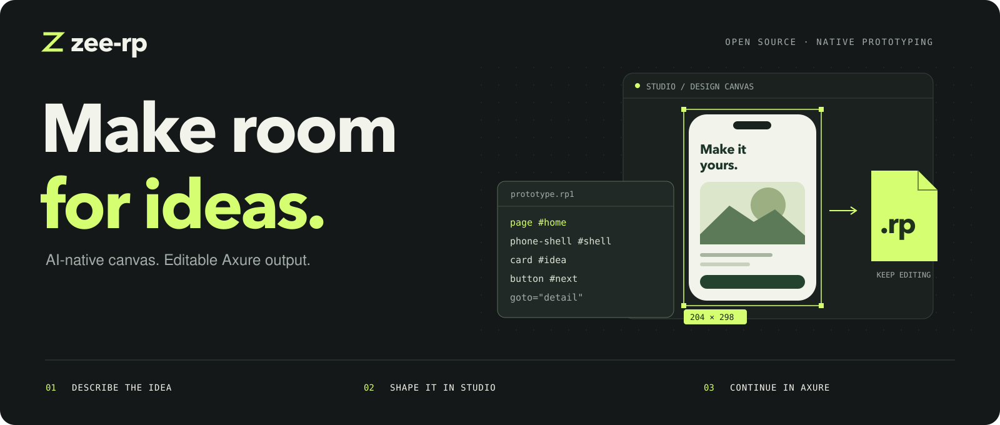
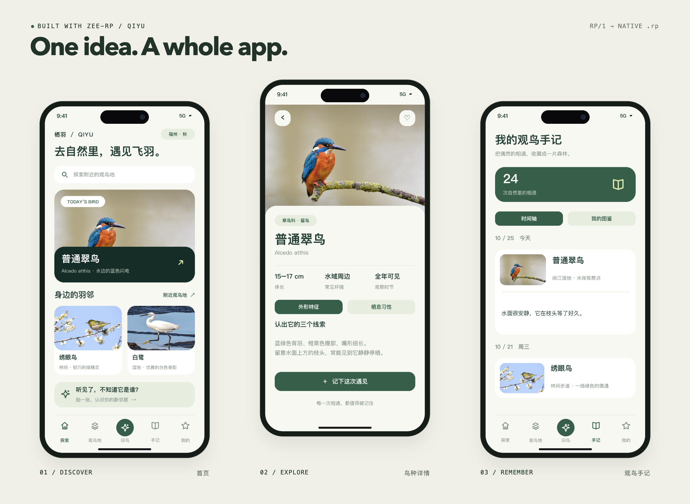
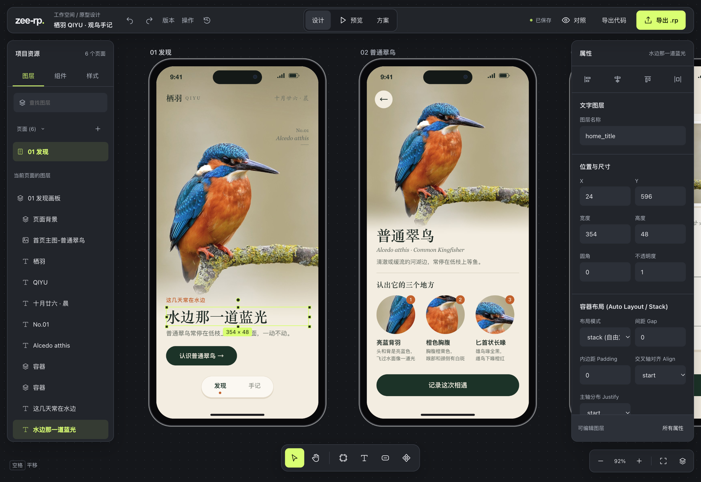

<div align="center">



# Give AI room to design.<br>Bring the work into Axure.

**Author in RP/1. Explore with your agent. Refine together. Keep an editable `.rp`.**

[Get started](#quickstart)　·　[Studio](#studio)　·　[RP/1](#rp1)　·　[简体中文](README.md)

[](LICENSE) [](https://github.com/LilZeeCN/zee-rp/actions)

</div>

<br>



<p align="center"><b>QIYU</b>　Discover a bird. Get to know it. Keep the encounter.</p>
<p align="center"><sub>Nine-page native prototype · Separate text, buttons and inputs · Demo identification and statistics · <a href="assets/readme/README.md">Case notes and credits</a></sub></p>

<br>

<a id="studio"></a>

## 01　Make room for refinement.

Studio is a free canvas for people and agents. Let AI build the first draft, then select, edit text and adjust layouts directly. Hand a small part back to your agent and explore another direction.



**AI drafts.** Author through RP/1 or commands; query layers and make targeted changes.<br>
**You refine.** Double-click text, Shift-drag a marquee, hold Option / Alt to measure, undo and redo.<br>
**Verify together.** Inspect real screenshots and exercise interactions before delivery.

[Studio workflow](docs/studio-design-workflow.md)　↗　[AI authoring](docs/studio-ai-authoring.md)

<br>

<a id="rp1"></a>

## 02　Give design intent a source file.

**RP/1** keeps pages, layout, components, variables and interactions together. Agents can target specific changes while the design keeps its structure, revision identity and a place to continue.

```text
rp/1 target=9 name="Next encounter" domain=mobile theme=mobile-hifi

page #home name="Discover" device=iphone-17-pro
  phone-shell #shell title="Meet your feathered neighbors." gap=16
    card #bird [fillxhug] title="A kingfisher by the water" body="Start your field notes with a flash of blue." actionText="Record this encounter" goto="notes"

page #notes name="Journal" device=iphone-17-pro
  phone-shell #shell title="My first field note" gap=16
    input #note [fillx44] value="I spotted it by the water today."
    button #back [fillx44] "Back to discovery" goto="home"
```

Grow a page into a complete flow, revise with `revise_prototype`, and merge supported native edits back into source.

[RP/1 reference](references/rp-language.md)　↗　[Examples](examples/authoring/mobile-cards.rp1)　↗　[Native roundtrip](docs/studio-native-roundtrip.md)

<br>

## 03　Keep the design in your hands.

Generate a native **`.rp`** and continue editing supported text, controls and layouts in Axure. Deliver pages, variables, panels and navigation together, alongside source, previews and verification reports.

| Continue in | What stays with you |
| :--- | :--- |
| **Studio** | A shared design document, transactions and undo history |
| **Axure** | Native objects and supported interactions to keep editing |
| **The browser** | Runnable previews, plus standalone HTML / CSS / JS export |

[Native export and sync](docs/studio-native-roundtrip.md)　↗　[Code export](docs/studio-code-export.md)　↗　[40-second workflow animation](https://github.com/LilZeeCN/zee-rp/releases/download/v0.2.1/zee-rp-zhixu-1080p60.mp4)

<br>

<a id="quickstart"></a>

## Get started

Install **Node.js 18+** and **Python 3.10+**. Native generation additionally needs local Axure resources and your own single-page blank project saved in RP9.

```sh
git clone https://github.com/LilZeeCN/zee-rp.git
cd zee-rp
python3 -m venv .venv
source .venv/bin/activate
python -m pip install -r requirements.txt
npm ci
```

<details>
<summary><b>Connect your MCP client</b> · Expand configuration</summary>

Replace the absolute paths with your installation, Python environment and RP9 blank project:

```json
{
  "mcpServers": {
    "zee-rp": {
      "command": "node",
      "args": ["/absolute/path/zee-rp/bin/mcp.mjs"],
      "env": {
        "PATH": "/absolute/path/zee-rp/.venv/bin:/usr/local/bin:/usr/bin:/bin",
        "AXURE_BLANK_TEMPLATE_RP9": "/absolute/path/my-rp9-blank.rp"
      }
    }
  }
}
```

`PATH` must include Python with the installed dependencies. Use an absolute Node path in `command` if needed. Reconnect MCP after updates.

</details>

Call `studio_open_project` and open the returned `url`:

```json
{ "projectDir": "/absolute/path/my-first-prototype" }
```

Then give your agent a brief:

> Design a birdwatching app with discovery, species details and a journal. Start in the canvas, verify navigation and saved observations, then export an editable `.rp`.

<details>
<summary><b>Agent entry points and scope</b></summary>

Agents start with `studio_describe({"topic":"workflow"})`. Use `sourcePath` in `studio_open_project` to import RP/1, and `generate_prototype` for full native generation. Local authoring and full compilation have separately documented scopes.

Native generation targets RP9; file tools handle RP9 / RP11 by version. Host evidence mainly covers macOS + Axure RP9. Some effects use embedded raster assets; fonts and previews depend on the host. Fractional-zoom sharpness and very large single boards remain bounded.

Structure, browser behavior and Axure save/reopen are separate checks. [Capabilities](references/capabilities.md) · [Acceptance layers](docs/studio-acceptance.md) · [Troubleshooting](references/troubleshooting.md)

</details>

<br>

---

[Agent Skill](SKILL.md)　/　[Contributing](CONTRIBUTING.md)　/　[Changelog](CHANGELOG.md)　/　[MIT License](LICENSE)

<sub>Independently built by LilZee · Unaffiliated with Axure · Third-party photography retains its own credits and licenses</sub>
