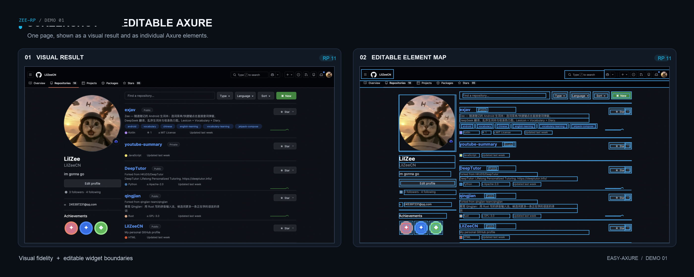

<div align="center">

# ⚡ zee-rp

**An open-source engine & MCP server for Axure RP 11 prototype files.**

*Turn screenshots, HTML, or specs into editable Axure widgets. Let AI read, modify,
and generate real `.rp` files — verified against the native Axure application.*

[English](README.md) • [简体中文](README.zh-CN.md) • [Installation](#-installation--setup) • [Quick Start](#-cli-quickstart--recipes) • [MCP Guide](#-mcp-integration--agent-prompting) • [Under the Hood](#-under-the-hood-reverse-engineering) • [Capabilities](#-capability-matrix)

<br />

[](LICENSE)
[](package.json)
[](package.json)
[](bin/axure.mjs)
[](bin/mcp.mjs)
[](test/)

</div>

> **Trademark notice** — Axure RP is a registered trademark of Axure Software Solutions, Inc. zee-rp is an independent open-source research and tooling initiative. It is **not** affiliated with, sponsored by, or endorsed by Axure Software Solutions, Inc.

---

## 💡 Why zee-rp?

For more than two decades, **Axure RP** has stood as the gold standard for high-fidelity enterprise prototyping, complex interaction logic, and stateful UX architecture. Yet its proprietary `.rp` binary format has remained an undocumented black box:
- No public specification or schema
- No official read/write API or CLI
- No headless automation or CI integration
- Complete isolation from modern AI coding agents and LLM tool ecosystems

While Figma and modern design tools enjoy rich REST APIs and AI plugins, Axure designers and product managers have been forced to translate requirements, PRDs, screenshots, and legacy UIs into `.rp` files completely by hand — clicking and dragging for tens of hours.

**zee-rp changes that.**

Built upon months of rigorous reverse engineering, IL-level opcode decompilation, and native GUI roundtrip verification, **zee-rp** is a **clean-room, zero-dependency Node.js engine** capable of parsing, constructing, modifying, and repairing native Axure RP 11 binary prototype files. Paired with a **42-tool Model Context Protocol (MCP) server**, it enables AI assistants (Claude, Cursor, Antigravity, Windsurf) to read and manipulate `.rp` files with surgical precision.

---

## 📸 See It in Action

A full-page complex web application screenshot (macOS window + header + 3-column layout) reconstructed as a native Axure page: **121 editable widgets, 16 embedded images, mean absolute pixel divergence 7.97/255** — not a flattened image capture, but real, independent vector and text widgets ready for further editing in Axure RP:



*Left: The rendered preview in browser. Right: The exact same canvas with every widget individually selectable, resizable, and restylable inside native Axure RP 11.*

---

## 🌟 Key Use Cases

| Use Case | Description | Typical Tooling |
|---|---|---|
| 🤖 **AI Prototyping Agent** | Prompt Claude, Cursor, or Codex to inspect page trees, alter widget styles, wire up state transitions, or build new pages directly into `.rp` files. | MCP Server (`zee-rp-mcp`) |
| 👁️ **Vision / Screenshot-to-Axure** | Feed UI screenshots or layout specs into AI vision models, converting them into structured vector shapes, multi-run text, and images. | CLI (`axvg build`, `axvg paste`) |
| ⚡ **Batch Prototype Refactoring** | Programmatically update design systems, bulk-rename widgets, swap out text strings, or fix hyperlink targets across 50+ pages in seconds. | CLI (`set-widget-text`, `set-widget-richtext`) |
| 🔀 **Complex Interaction Generation** | Generate dynamic panels (multi-state, nested closures), repeaters with data binding, and recursive conditional branching (`If/ElseIf/Else`). | CLI (`add-interaction`, `fill-panel-state`) |
| 📋 **Live Canvas Vector Injection** | Generate structured vector geometry and paste it straight onto the active Axure canvas via the native OS clipboard without touching `.rp` disk files. | CLI (`axvg paste`) |

---

## 📦 Installation & Setup

zee-rp is designed with **zero runtime dependencies** (pure ECMAScript modules utilizing standard Node.js libraries).

### Method 1: Global CLI via Git (Recommended)

You can install `zee-rp` globally directly from GitHub without cloning:

```bash
# Install globally from GitHub repository
npm install -g github:LilZeeCN/zee-rp

# Verify global CLI is accessible
zee-rp --help
```

This registers two commands in your global PATH:
- **`zee-rp`**: The unified CLI for all 30 Axure prototype operations.
- **`zee-rp-mcp`**: The Model Context Protocol server for AI agent integrations.

### Method 2: Clone & Run Locally (Zero Builds)

```bash
git clone https://github.com/LilZeeCN/zee-rp.git
cd zee-rp

# Run CLI directly via Node.js
node bin/axure.mjs --help
```

### Method 3: npm Package (Coming to npm registry)

The repository is configured as an open, public package (`"private": false`). Once published to the global npm registry:

```bash
# Run on-demand without prior installation
npx zee-rp --help

# Or install globally from npm
npm install -g zee-rp
```

---

### ⚙️ Setting Up Your Local Blank Template

To maintain strict copyright compliance, **this repository deliberately ships zero official Axure `.rp` or `.rplib` proprietary binary assets**.

To create blank projects or new pages from scratch, simply create an empty single-page project in your own Axure RP 11 installation, save it once, and configure its path:

```bash
# Set environment variable pointing to your blank template
export AXURE_BLANK_TEMPLATE="/path/to/your/axure-rp11-blank.rp"
```

> **Fallback**: If unset, zee-rp automatically looks for:  
> `~/Library/Application Support/zee-rp/templates/axure-rp11-blank.rp`

---

## 🛠️ CLI Quickstart & Recipes

All file modifications follow an **atomic, non-destructive chain principle**: output files are always written to **new paths**, ensuring your original prototype is never altered or corrupted.

### 1. Inspecting Prototype Structure
Inspect page lists, master components, widget hierarchies, and integrity status:

```bash
# Human-readable summary of pages and widgets
zee-rp rp-read /path/to/project.rp

# Machine-readable JSON output (ideal for LLM context injection)
zee-rp rp-read /path/to/project.rp --json
```

### 2. Safely Updating Widget Text
Locate a widget by name on a specific page and modify its text:

```bash
zee-rp set-widget-text /path/to/source.rp /path/to/output.rp \
  "Home" "SubmitButton" "Confirm & Proceed"
```

### 3. Rich Text & Multi-run Styling
Apply rich text runs with varied font weights, colors, font sizes, and inline hyperlinks:

```bash
zee-rp set-widget-richtext /path/to/source.rp /path/to/output.rp \
  --page "Home" --widget "StatusBanner" \
  --runs '[{"text":"Notice: ","style":{"bold":true}},{"text":"Click here","style":{"color":"#1890FF","link":{"url":"https://example.com","newWindow":true}}}]'
```

### 4. Creating Projects & Duplicating Pages
```bash
# Create a fresh single-page project from your template
zee-rp create-blank-project /path/to/new-project.rp

# Duplicate an existing page with deep GUID closure isolation
zee-rp duplicate-page /path/to/source.rp /path/to/output.rp "Page 1" "Page 1 Copy"
```

### 5. Wiring Interactive Behaviors
Add an `OnClick` event that shows a dynamic panel with slide animation:

```bash
zee-rp add-interaction /path/to/source.rp /path/to/output.rp \
  --page "Home" --widget "OpenMenuBtn" \
  --event "OnClick" \
  --action "SetPanelState" \
  --target "MenuPanel" \
  --state "Expanded" \
  --animate "slideDown"
```

### 6. Live Canvas Clipboard Injection (`axvg`)
Generate vector geometries and paste them straight into active Axure RP canvas window:

```bash
# 1. Compile layout specification JSON to Axvg format
zee-rp axvg build spec.json -o canvas.axvg.json

# 2. Paste into active Axure RP window via macOS system clipboard
zee-rp axvg paste canvas.axvg.json
```

---

## 🤖 MCP Integration & Agent Prompting

zee-rp includes a production-grade **Model Context Protocol (MCP)** server providing **42 specialized tools** for AI assistants.

### 1. Client Configuration

Add `zee-rp` to your client configuration file:

#### For Claude Desktop (`claude_desktop_config.json`)
```json
{
  "mcpServers": {
    "zee-rp": {
      "command": "node",
      "args": ["/absolute/path/to/zee-rp/bin/mcp.mjs"],
      "env": {
        "AXURE_WRITE_ROOT": "/Users/username/Projects/axure-outputs",
        "AXURE_BLANK_TEMPLATE": "/Users/username/Templates/blank.rp"
      }
    }
  }
}
```

*Or, if installed globally:*
```json
{
  "mcpServers": {
    "zee-rp": {
      "command": "zee-rp-mcp",
      "env": {
        "AXURE_WRITE_ROOT": "/Users/username/Projects/axure-outputs"
      }
    }
  }
}
```

#### For Cursor (`.cursor/mcp.json`) or Antigravity
```json
{
  "mcpServers": {
    "zee-rp": {
      "command": "node",
      "args": ["/absolute/path/to/zee-rp/bin/mcp.mjs"],
      "env": {
        "AXURE_WRITE_ROOT": "/safe/workspace/output"
      }
    }
  }
}
```

### 2. Environment Variables & Safety Sandbox

| Variable | Description |
|---|---|
| `AXURE_WRITE_ROOT` | **Recommended**. Colon-separated directories. Restricts all file writes strictly within these directories. Any attempt to write outside is rejected before touching the disk. |
| `AXURE_BLANK_TEMPLATE` | Absolute path to your native RP 11 single-page blank template file. |
| `AXURE_PROTECTED_PATHS` | Colon-separated list of paths the engine is forbidden to read or write (e.g. production deliverables). |

### 3. The 42-Tool Catalog at a Glance

```
┌────────────────────────────────────────────────────────────────────────┐
│                        zee-rp MCP Tool Suite (42)                      │
├───────────────────┬────────────────────────────────────────────────────┤
│ Inspection (9)    │ rp_read, inspect, locate, read_interactions,       │
│                   │ axure_open, axure_state, axure_save, verify,       │
│                   │ gui_roundtrip                                      │
├───────────────────┼────────────────────────────────────────────────────┤
│ Content & Styling │ set_widget_text, set_widget_richtext, edit_text,   │
│ (7)               │ name_widget, set_master_overrides,                 │
│                   │ patch_link_window, patch_string                    │
├───────────────────┼────────────────────────────────────────────────────┤
│ Structural &      │ create_blank_project, create_blank_page,           │
│ Containers (10)   │ duplicate_page, create_master, place_master,       │
│                   │ create_panel_clone, fill_panel_state,              │
│                   │ remove_panel_state_content,                        │
│                   │ set_panel_fit_to_content, add_adaptive_view        │
├───────────────────┼────────────────────────────────────────────────────┤
│ Widgets & Tables  │ set_native_table, clone_library_widget,            │
│ (6)               │ clone_library_page_content, clone_native_connector,│
│                   │ set_connector_anchors, set_combobox_options,       │
│                   │ set_listbox_options                                │
├───────────────────┼────────────────────────────────────────────────────┤
│ Interactions (2)  │ add_interaction, remove_interaction                │
├───────────────────┼────────────────────────────────────────────────────┤
│ Vector Canvas (3) │ axvg_build, axvg_paste, axvg_selftest              │
├───────────────────┼────────────────────────────────────────────────────┤
│ Safe Jobs (3)     │ jobs_list, jobs_get, jobs_cancel                   │
└───────────────────┴────────────────────────────────────────────────────┘
```

### 4. Sample Prompts to Give Your AI Agent

Once connected, you can converse with your agent naturally:

> **"Read the prototype at `/workspace/app.rp`, summarize all pages, and list any widgets that have no interaction events assigned."**

> **"On the 'Login' page, find the button named 'Submit'. Change its label to 'Sign In', set its background color to `#1890FF`, and add a Click interaction that navigates to 'Dashboard'."**

> **"Convert this markdown user list into a native Axure Repeater on Page 1, with columns `Username`, `Role`, and `Status`."**

> **"Create a 3-state Dynamic Panel on 'SettingsPage' for Tabs (Profile, Security, Billing), and wire up tab buttons to toggle panel states with slide transitions."**

---

## 🔬 Under the Hood: Reverse Engineering

Axure `.rp` files are compound binary archives, not simple ZIP files or SQLite databases. Here is how zee-rp parses and synthesizes them:

```
  ┌────────────────────────────────────────────────────────┐
  │                   .rp Binary Container                 │
  ├────────────────────────────────────────────────────────┤
  │ Header & Manifest:                                     │
  │ • LZ4 block compression                                │
  │ • Package offset directory & thumbnail offsets         │
  ├────────────────────────────────────────────────────────┤
  │ Records & Chunks:                                      │
  │ • Gzip-compressed stream segments                      │
  │ • Typed-tag binary payload graph (.NET serialization)  │
  ├────────────────────────────────────────────────────────┤
  │ Referential Closure:                                   │
  │ • 128-bit GUID node linkages                           │
  │ • Hierarchical DiagramObject tree & Dynamic Panel states│
  │ • Expressions AST & FCall invocation tables            │
  └────────────────────────────────────────────────────────┘
```

1. **Custom Manifest Codec**: Axure uses a proprietary LZ4 block framing header with custom metadata offsets. zee-rp implements a native JavaScript LZ4 manifest unpacker/packer without external C++ bindings.
2. **Typed-tag Binary Graph**: Object records are encoded using .NET binary formatter style tag sequences. zee-rp parses these into a traversing AST, allowing modifications while preserving exact byte alignments.
3. **GUID Referential Integrity**: In Axure, moving, duplicating, or parenting a widget requires remapping its GUID across diagram trees, interaction targets, and parent closures. A single dangling GUID crashes Axure's document loader. zee-rp enforces recursive GUID closure resolution across all operations.
4. **The Three-Zero Rule**: A generated `.rp` file is only emitted if it passes automated verification:
   - **0 unparseable records**
   - **0 dangling references**
   - **0 structural schema violations**

---

## 📊 Capability Matrix

| Domain | Capabilities | Verification Tier |
|---|---|---|
| **Binary .rp I/O** | LZ4 manifest roundtrip, record graph, page/master duplication, blank project & page creation | GUI save/reopen verified |
| **Rich Text** | Multi-run styles, line spacing, alignment, hyperlinks (page & external URL), native bullet lists (structural) | Native canvas verified |
| **Dynamic Panels** | Multi-state creation, nested closures, append/replace, fit-to-content | GUI roundtrip verified |
| **Repeaters** | Dataset CRUD, row templates, sort & filter rules, pagination | Preview behavior verified |
| **Interactions** | 45 event types, 29 action writers, If/ElseIf/Else recursive conditions, 18 registered expression functions | 225/225 regression + sampled GUI verified |
| **Native Tables** | Dimension matrix, per-cell multi-run text, visual merge overlays | Native canvas verified |
| **Connectors** | Default edges, normalized custom anchor points, cross-document style sync | Preview verified |
| **Adaptive Views** | Base / 768 / 1024 breakpoints with per-view coordinate/size overrides | Preview verified |

*Capability claims are strictly evidence-backed. The project explicitly distinguishes between **structure correct**, **loads in Axure**, **preview behavior**, and **GUI edit/save/reopen verified**. See [references/capabilities.md](references/capabilities.md) for exact boundaries.*

---

## 🏛️ Architecture & Verification Discipline

```
                  ┌─────────────────────────┐
                  │  Claude / Agent / CLI   │
                  └───────────┬─────────────┘
                              │ (MCP / CLI)
                  ┌───────────▼─────────────┐
                  │      zee-rp engine      │
                  │ (sandbox & registry)    │
                  └───────────┬─────────────┘
            ┌─────────────────┼─────────────────┐
            ▼                 ▼                 ▼
     ┌─────────────┐   ┌──────────────┐   ┌──────────────┐
     │ rp-records  │   │ parse-payload│   │  ix-actions  │
     │ LZ4/gzip    │   │ typed-tag    │   │ expression & │
     │ record I/O  │   │ tree engine  │   │ FCall registry│
     └─────────────┘   └──────────────┘   └──────────────┘
            └─────────────────┼─────────────────┘
                              ▼
                  ┌─────────────────────────┐
                  │    Axure RP 11 (.rp)    │
                  └─────────────────────────┘
```

### Rigorous Testing Harness
- **Regression Suite**: 225 automated checks validating record byte structures, expression serialization, and closure containment (`npm test`).
- **Parity & Safety Checks**: `node test/parity-check.mjs` (23 assertions) guarantees that the unified CLI behaves byte-identically to individual scripts and enforces path protection boundaries.
- **Async Job Queue Tests**: `npm run test:jobs` (11 assertions) validates transactional isolation, cancellation, and rollback safety.
- **Automated GUI Roundtrips**: Real Axure RP 11 instances are automated via native macOS Accessibility APIs (`scripts/gui-roundtrip.swift`) to open files, trigger UI saves, and verify disk re-reads.

---

## 📂 Repository Tour

```
zee-rp/
├── bin/
│   ├── axure.mjs               # Unified CLI runner (30 commands)
│   └── mcp.mjs                 # Model Context Protocol stdio server (42 tools)
├── scripts/
│   ├── engine.mjs              # Transactional session manager & safety sandboxing
│   ├── rp-records.mjs          # Low-level LZ4/gzip binary record stream codec
│   ├── parse-payload.mjs       # .NET typed-tag payload tree parser
│   ├── ix-actions.mjs          # Interaction expression AST & action generators
│   ├── mcp-tools.mjs           # MCP tool specifications & handler dispatcher
│   ├── axvg.mjs                # Axvg vector geometry compiler & clipboard bridge
│   └── ... (24 specific command scripts for repeaters, tables, panels, etc.)
├── references/
│   ├── capabilities.md         # Exhaustive evidence & capability boundaries
│   ├── rp-workflow.md          # End-to-end prototype authoring workflow guide
│   ├── repeaters.md            # Repeater dataset and rule specifications
│   ├── adaptive-views.md       # Multi-breakpoint layout rules
│   ├── axvg-format.md          # Vector clipboard format specification
│   └── troubleshooting.md      # Common format caveats and recovery tips
└── test/
    ├── parity-check.mjs        # 23-assertion byte-level CLI parity suite
    └── jobs-check.mjs          # 11-assertion transactional queue test
```

---

## 🤝 Contributing

We welcome community contributions! Please review [CONTRIBUTING.md](CONTRIBUTING.md) before opening a PR:
- **Clean-room rule**: PRs must never commit proprietary `.rp`/`.rplib` binaries or official Axure assets.
- **Evidence standard**: New capabilities must include structural validation and baseline assertions.

---

## 📄 License & Disclaimer

Distributed under the **MIT License**. See [LICENSE](LICENSE) for details.

*zee-rp is an independent open-source project. Axure RP is a registered trademark of Axure Software Solutions, Inc. This project is not affiliated with, sponsored by, or endorsed by Axure Software Solutions, Inc.*

---

<div align="center">
<b>Star ⭐ if zee-rp saved you hours of manual prototype drawing!</b>
</div>
