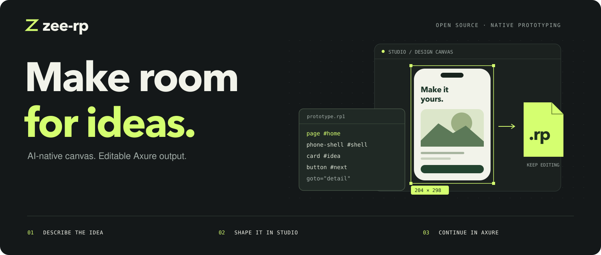
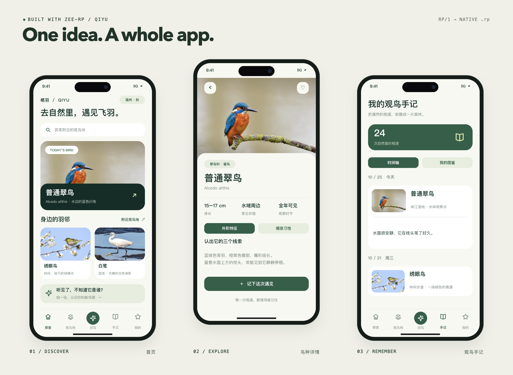
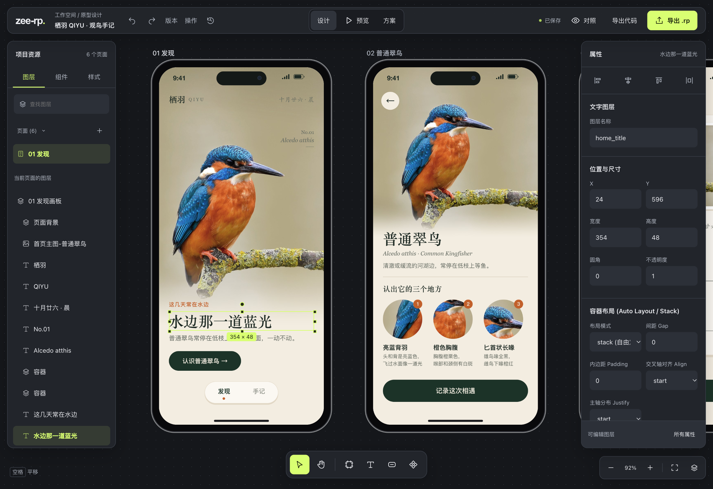

<div align="center">



# 给 AI 一张自由画布。<br>把设计带回 Axure。

**用 RP/1 写下设计，让 AI 起稿、你来精修，交付可继续编辑的 `.rp`。**

[开始使用](#quickstart)　·　[自由画布](#studio)　·　[RP/1](#rp1)　·　[English](README.en.md)

[](LICENSE) [](https://github.com/LilZeeCN/zee-rp/actions)

</div>

<br>



<p align="center"><b>栖羽 / QIYU</b>　从探索、鸟种详情，到留下自己的观鸟手记。</p>
<p align="center"><sub>9 页原生原型示例 · 文字、按钮与输入保留为独立元件 · 识别与统计使用演示数据 · <a href="assets/readme/README.md">素材与案例说明</a></sub></p>

<br>

<a id="studio"></a>

## 01　在画布里，把设计推敲到位。

Studio 是一块 AI 和人都能编辑的自由画布。让 Agent 搭好第一版，再直接点选、改字、调整布局；也可以把局部交还 AI，继续探索另一种构图。



**AI 起稿。** RP/1 或命令创作，按图层、语义和范围查询，局部改稿。<br>
**人来精修。** 双击改字、Shift 框选、Option / Alt 悬停测距，撤销重做。<br>
**一起验证。** 查看真实截图、运行交互场景，再交付原型。

[画室工作流](docs/studio-design-workflow.md)　↗　[AI 创作指南](docs/studio-ai-authoring.md)

<br>

<a id="rp1"></a>

## 02　设计意图，有自己的源码。

**RP/1** 把页面、布局、组件、变量和交互写在一起。AI 改动有明确目标，设计也能保留结构、版本和继续迭代的起点。

```text
rp/1 target=9 name="下一次相遇" domain=mobile theme=mobile-hifi

page #home name="发现" device=iphone-17-pro
  phone-shell #shell title="去自然里，遇见飞羽。" gap=16
    card #bird [fillxhug] title="今天，认识一只翠鸟" body="从水边的一抹蓝绿，开始你的观鸟手记。" actionText="记下这次遇见" goto="notes"

page #notes name="手记" device=iphone-17-pro
  phone-shell #shell title="我的第一篇手记" gap=16
    input #note [fillx44] value="今天在水边遇见了它。"
    button #back [fillx44] "返回发现" goto="home"
```

从一个页面到完整流程，`revise_prototype` 继续改稿；已有原生修改也能在支持范围内合并回源码。

[RP/1 手册](references/rp-language.md)　↗　[完整示例](examples/authoring/mobile-cards.rp1)　↗　[原生往返](docs/studio-native-roundtrip.md)

<br>

## 03　交到 Axure，仍然握得住设计。

生成原生 **`.rp`**，在 Axure 中继续修改支持的文字、控件和布局。页面、变量、动态面板与跳转可以一起交付，源稿、预览和检查报告也一并保留。

| 从哪里继续 | 可以做什么 |
| :--- | :--- |
| **Studio** | 和 AI 共用设计文档、事务、原子 `fix_plan(apply:true)` 自愈与撤销历史 |
| **Axure** | 打开原生 `.rp`，或反编译已有 `.rp` 进 Studio，再 `studio_export(format:"rp1")` 导出源码 |
| **浏览器** | 运行拖拽/滑动/定时切态预览；免装 Axure 即可用 `verify_prototype(engine:"studio-html")` 真机验收 |
| **网页 / 截图** | 直接传本地 `.html` 或 `http(s)://` URL 给 `studio_open_project` / `generate_prototype`，一步提取排版与表单进画布 |

[原生导出与回填](docs/studio-native-roundtrip.md)　↗　[HTML / URL 导入](references/html-workflow.md)　↗　[代码导出](docs/studio-code-export.md)　↗　[盲测实录](docs/blind-test-t01-20261126.md)　↗　[缺口台账](docs/gaps.md)　↗　[40 秒流程动画](https://github.com/LilZeeCN/zee-rp/releases/download/v0.2.1/zee-rp-zhixu-1080p60.mp4)

<br>

<a id="quickstart"></a>

## 开始使用

准备 **Node.js 18+** 和 **Python 3.10+**。空白工程和基础 RP/1 布局可直接离线生成。

### 一条命令安装（直接来自 GitHub）

```sh
npx -y github:LilZeeCN/zee-rp doctor                 # 不克隆仓库，先自检 Node / Python / Chrome / 模板
npm i -g github:LilZeeCN/zee-rp                      # 或安装命令行：之后直接用 zee-rp
zee-rp doctor                                        # 自检 Node / Python / Chrome / 模板就绪状态
```

Python 依赖只需装一次：`python3 -m pip install pillow numpy jsonschema`（截图重建另需 SciPy）。固定版本用 `github:LilZeeCN/zee-rp#v0.3.0`。

### macOS

```sh
git clone https://github.com/LilZeeCN/zee-rp.git
cd zee-rp
python3 -m venv .venv
source .venv/bin/activate
python -m pip install -r requirements.txt
npm ci
npm run doctor   # 3 秒自检 Node / Python / Chrome / 模板就绪状态
```

### Windows 支持

原生 `.rp` 的读取、写入和生成可以在 Windows 上运行（Node 18+ / Python 3.10+）。

用 Node.js 24 和 Python 3.12 可以复用桌面 CI 的环境。在 PowerShell 中安装。

```powershell
git clone https://github.com/LilZeeCN/zee-rp.git
cd zee-rp
py -3.12 -m venv .venv
$env:ZEE_PYTHON = (Resolve-Path .\.venv\Scripts\python.exe).Path
& $env:ZEE_PYTHON -m pip install pillow numpy jsonschema
npm.cmd ci
```

- 生成器可以直接合成 RP9 / RP11 空白工程。需要接入自备模板时，通过 `AXURE_BLANK_TEMPLATE_RP9` 或 `AXURE_BLANK_TEMPLATE_RP11` 指定。
- Axure 会在常见安装目录和盘符根目录的便携版中自动探测（`C:\AxureRP9.exe`、`D:\AxureRP9.exe`）；可用 `AXURE_APP_RP9` 覆盖，用 `AXURE_INSTALL_ROOT_RP9`（安装根目录）或 `AXURE_DEFAULT_SETTINGS_RP9`（直接路径）指向 `DefaultSettings`。
- 多路径环境变量在 Windows 上用 `;` 分隔（`AXURE_PROTECTED_PATHS`、`AXURE_WRITE_ROOT`）。
- RP/1 默认使用原生后端。用旧规格调用 `build-rp` 或 `generate` 时需传 `--backend native`。GUI 后端、macOS 菜单自动化与 `tools/rp9_place.py` 仅支持 macOS。`axvg paste` 会把负载写入 Windows 剪贴板，在 Axure 中按 Ctrl+V 粘贴。
- 截图重建需额外安装 SciPy。Windows 支持形状识别，文字需另行提供。OCR 使用 macOS 的 Apple Vision。
- Windows 和 macOS CI 都覆盖 RP/1 文件解析、编译和输出目录。验证完整的 MCP 生成，请运行 `npm.cmd run test:mcp-generate`。`test:backend` 还需要兼容的 `Training/RP9 Tour.rp`。生成空白动态面板时，如果内置教学工程没有 `Discount Panel`，会按工程顺序选取第一个无名面板的外壳。如果要从多个无名面板中复制已有状态内容，请通过 `AXURE_PANEL_TEMPLATE` 和 `AXURE_PANEL_TEMPLATE_NAME` 指定一个具名面板。

### 生成第一个 RP9 原型

直接运行生成命令，首次运行会按需合成空白工程。空白工程与基础 RP/1 布局可离线生成。需要克隆本机库元件或动态面板样本的构建仍需要对应的 Axure 资源。

```sh
node scripts/proto.mjs generate --spec examples/authoring/mobile-cards.rp1 --out-dir output/mobile-cards --out-rp output/mobile-cards.rp --backend native
```

用 Axure RP9 打开 `output/mobile-cards.rp` 继续编辑。

### 发现并复用 Axure 元件库

```sh
zee-rp index-library /path/to/components.rplib --json
zee-rp clone-library-widget /path/to/components.rplib /path/to/project.rp /path/to/result.rp 'Button' 'Page 1' 'Primary action'
```

索引返回目录、库项记录号、元件 ID、类名、尺寸和现有文字。重名库项可用 `'#<record>'` 指定。库项里有多个元件时，用 `--source-widget '名称'` 或 `--source-widget '#<id>'` 选一个。整组内容或动态面板状态使用 `clone-library-page-content`。Agent 可通过 `rp_command` 调用相同命令。

<details>
<summary><b>连接你的 MCP 客户端</b> · 展开配置</summary>

不克隆仓库时，让 npx 直接从 GitHub 取包（`zee-rp-mcp` 与 `zee-rp mcp` 等价）：

```json
{
  "mcpServers": {
    "zee-rp": {
      "command": "npx",
      "args": ["-y", "github:LilZeeCN/zee-rp", "mcp"]
    }
  }
}
```

从源码运行时，将下面的绝对路径换成自己的安装目录和 Python 环境：

```json
{
  "mcpServers": {
    "zee-rp": {
      "command": "node",
      "args": ["/absolute/path/zee-rp/bin/mcp.mjs"],
      "env": {
        "ZEE_PYTHON": "/absolute/path/zee-rp/.venv/bin/python"
      }
    }
  }
}
```

上面是 macOS 路径示例。Windows 可用 `C:/work/zee-rp/bin/mcp.mjs`、`C:/work/zee-rp/.venv/Scripts/python.exe` 填写对应字段。Node 不在默认路径时，`command` 也使用绝对路径。安装更新后重新连接 MCP。

</details>

接好后，调用 `studio_open_project`，在浏览器打开返回的 `url`：

```json
{ "projectDir": "/absolute/path/my-first-prototype" }
```

然后把任务交给 Agent：

> 做一个观鸟 App，包含探索、鸟种详情和手记。先在画布里设计，验证跳转和保存回显，再导出可编辑的 `.rp`。

<details>
<summary><b>给 Agent 的入口与运行边界</b></summary>

Agent 从 `studio_describe({"topic":"workflow"})` 开始。导入已有 RP/1 可为 `studio_open_project` 指定 `sourcePath`；完整原生生成使用 `generate_prototype`。局部创作和完整编译的支持范围分别记录。

原生生成当前以 RP9 为目标，RP9 / RP11 文件工具按版本处理。宿主证据主要来自 macOS + Axure RP9；部分效果采用嵌入位图，字体和预览可能受宿主影响。任意小数缩放清晰度、单画板海量节点仍有边界。

结构检查、浏览器行为与 Axure 保存重开分别验证。[能力范围](references/capabilities.md) · [验收层级](docs/studio-acceptance.md) · [故障排查](references/troubleshooting.md)

</details>

<br>

---

[Agent Skill](SKILL.md)　/　[贡献指南](CONTRIBUTING.md)　/　[变更记录](CHANGELOG.md)　/　[MIT License](LICENSE)

<sub>由 LilZee 独立开发 · 与 Axure 无隶属关系 · 第三方案例照片按各自许可与署名使用</sub>
