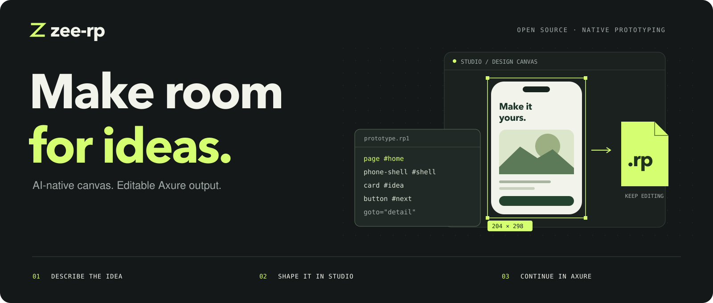
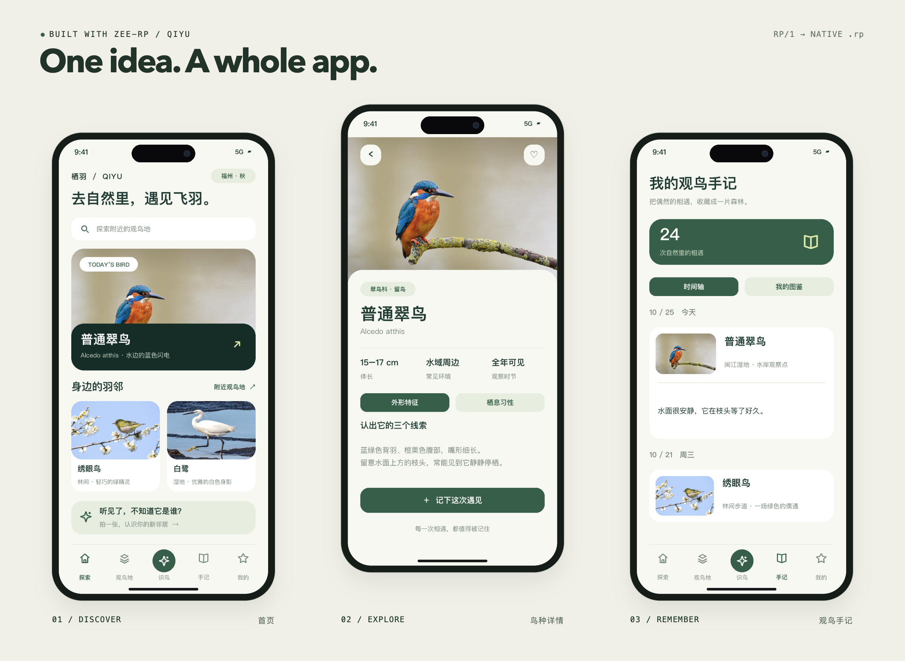
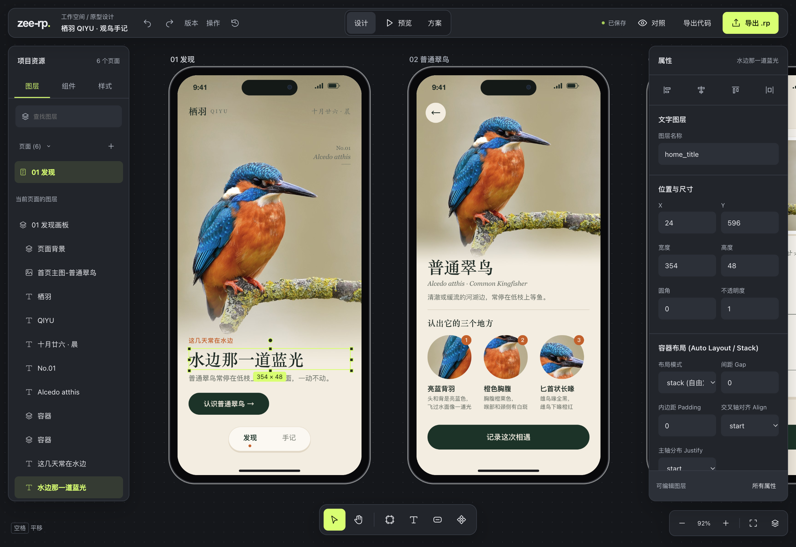

<div align="center">



# 给 AI 一张自由画布。<br>把设计带回 Axure。

**用 RP/1 写下设计，让 AI 起稿、你来精修，交付可继续编辑的 `.rp`。**

[开始使用](#quickstart)　·　[自由画布](#studio)　·　[RP/1](#rp1)　·　[English](README.en.md)

[](LICENSE) [](https://github.com/LilZeeCN/zee-rp/actions)

</div>

<br>



<p align="center"><b>栖羽 / QIYU</b>　从探索、鸟种详情，到留下自己的观鸟手记。</p>
<p align="center"><sub>9 页原生原型示例 · 文字、按钮与输入保留为独立元件 · 识别与统计使用演示数据 · <a href="assets/readme/README.md">素材与案例说明</a></sub></p>

<br>

<a id="studio"></a>

## 01　在画布里，把设计推敲到位。

Studio 是一块 AI 和人都能编辑的自由画布。让 Agent 搭好第一版，再直接点选、改字、调整布局；也可以把局部交还 AI，继续探索另一种构图。



**AI 起稿。** RP/1 或命令创作，按图层、语义和范围查询，局部改稿。<br>
**人来精修。** 双击改字、Shift 框选、Option / Alt 悬停测距，撤销重做。<br>
**一起验证。** 查看真实截图、运行交互场景，再交付原型。

[画室工作流](docs/studio-design-workflow.md)　↗　[AI 创作指南](docs/studio-ai-authoring.md)

<br>

<a id="rp1"></a>

## 02　设计意图，有自己的源码。

**RP/1** 把页面、布局、组件、变量和交互写在一起。AI 改动有明确目标，设计也能保留结构、版本和继续迭代的起点。

```text
rp/1 target=9 name="下一次相遇" domain=mobile theme=mobile-hifi

page #home name="发现" device=iphone-17-pro
  phone-shell #shell title="去自然里，遇见飞羽。" gap=16
    card #bird [fillxhug] title="今天，认识一只翠鸟" body="从水边的一抹蓝绿，开始你的观鸟手记。" actionText="记下这次遇见" goto="notes"

page #notes name="手记" device=iphone-17-pro
  phone-shell #shell title="我的第一篇手记" gap=16
    input #note [fillx44] value="今天在水边遇见了它。"
    button #back [fillx44] "返回发现" goto="home"
```

从一个页面到完整流程，`revise_prototype` 继续改稿；已有原生修改也能在支持范围内合并回源码。

[RP/1 手册](references/rp-language.md)　↗　[完整示例](examples/authoring/mobile-cards.rp1)　↗　[原生往返](docs/studio-native-roundtrip.md)

<br>

## 03　交到 Axure，仍然握得住设计。

生成原生 **`.rp`**，在 Axure 中继续修改支持的文字、控件和布局。页面、变量、动态面板与跳转可以一起交付，源稿、预览和检查报告也一并保留。

| 从哪里继续 | 可以做什么 |
| :--- | :--- |
| **Studio** | 和 AI 共用设计文档、事务与撤销历史 |
| **Axure** | 打开原生工程，继续编辑元件与支持的交互 |
| **浏览器** | 运行预览；也可导出独立 HTML / CSS / JS |

[原生导出与回填](docs/studio-native-roundtrip.md)　↗　[代码导出](docs/studio-code-export.md)　↗　[40 秒流程动画](https://github.com/LilZeeCN/zee-rp/releases/download/v0.2.1/zee-rp-zhixu-1080p60.mp4)

<br>

<a id="quickstart"></a>

## 开始使用

准备 **Node.js 18+** 和 **Python 3.10+**。原生生成另需本机 Axure，以及你自己在 RP9 中保存的单页空白工程。

```sh
git clone https://github.com/LilZeeCN/zee-rp.git
cd zee-rp
python3 -m venv .venv
source .venv/bin/activate
python -m pip install -r requirements.txt
npm ci
```

<details>
<summary><b>连接你的 MCP 客户端</b> · 展开配置</summary>

将下面的绝对路径换成自己的安装目录、Python 环境和 RP9 空白工程：

```json
{
  "mcpServers": {
    "zee-rp": {
      "command": "node",
      "args": ["/absolute/path/zee-rp/bin/mcp.mjs"],
      "env": {
        "PATH": "/absolute/path/zee-rp/.venv/bin:/usr/local/bin:/usr/bin:/bin",
        "AXURE_BLANK_TEMPLATE_RP9": "/absolute/path/my-rp9-blank.rp"
      }
    }
  }
}
```

`PATH` 应包含安装了依赖的 Python；Node 不在默认路径时，`command` 也使用绝对路径。安装更新后重新连接 MCP。

</details>

接好后，调用 `studio_open_project`，在浏览器打开返回的 `url`：

```json
{ "projectDir": "/absolute/path/my-first-prototype" }
```

然后把任务交给 Agent：

> 做一个观鸟 App，包含探索、鸟种详情和手记。先在画布里设计，验证跳转和保存回显，再导出可编辑的 `.rp`。

<details>
<summary><b>给 Agent 的入口与运行边界</b></summary>

Agent 从 `studio_describe({"topic":"workflow"})` 开始。导入已有 RP/1 可为 `studio_open_project` 指定 `sourcePath`；完整原生生成使用 `generate_prototype`。局部创作和完整编译的支持范围分别记录。

原生生成当前以 RP9 为目标，RP9 / RP11 文件工具按版本处理。宿主证据主要来自 macOS + Axure RP9；部分效果采用嵌入位图，字体和预览可能受宿主影响。任意小数缩放清晰度、单画板海量节点仍有边界。

结构检查、浏览器行为与 Axure 保存重开分别验证。[能力范围](references/capabilities.md) · [验收层级](docs/studio-acceptance.md) · [故障排查](references/troubleshooting.md)

</details>

<br>

---

[Agent Skill](SKILL.md)　/　[贡献指南](CONTRIBUTING.md)　/　[变更记录](CHANGELOG.md)　/　[MIT License](LICENSE)

<sub>由 LilZee 独立开发 · 与 Axure 无隶属关系 · 第三方案例照片按各自许可与署名使用</sub>
