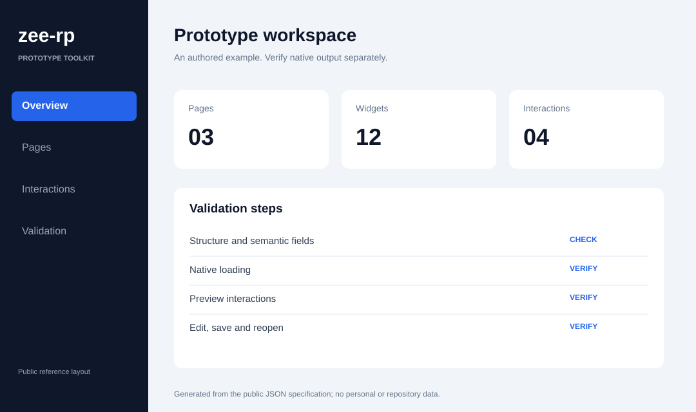
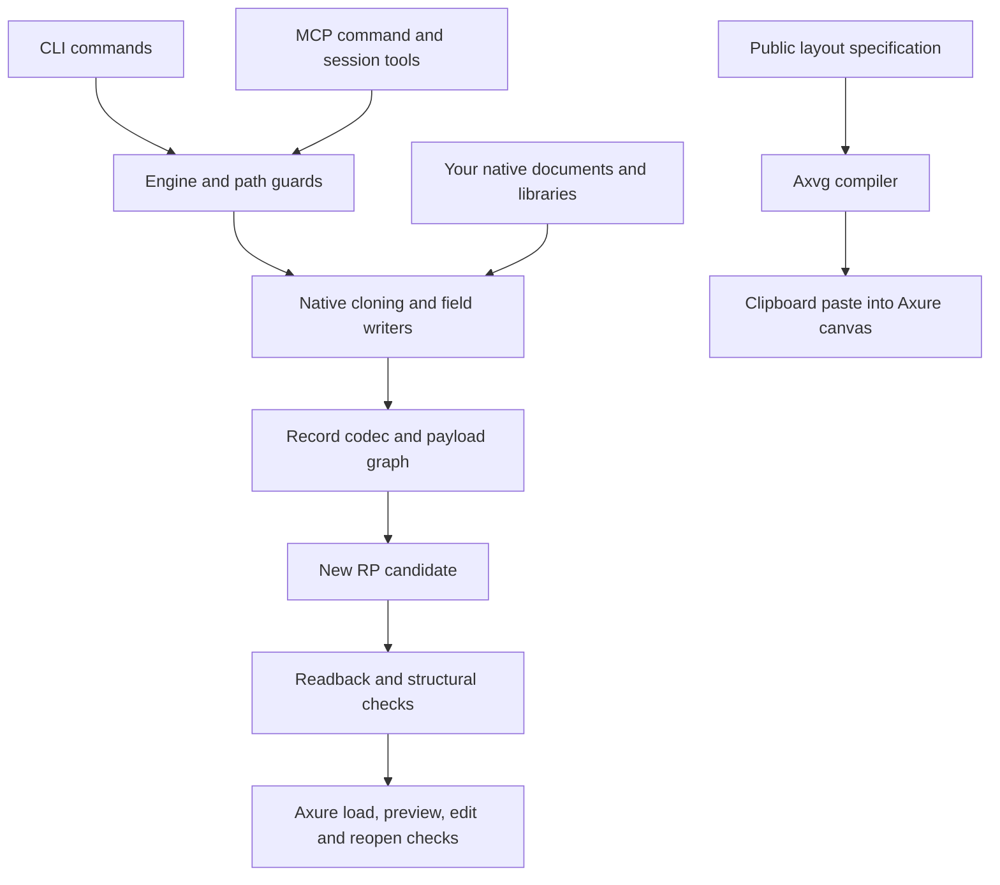

# zee-rp

[简体中文](README.zh-CN.md) · [Command reference](references/commands-generated.md) · [Capability boundaries](references/capabilities.md) · [Validation](docs/validation.md)

**Read, inspect, and edit supported Axure RP 11 prototypes from scripts or an AI assistant.**

zee-rp is an independent, MIT-licensed toolkit for native `.rp` documents. It includes a binary record codec, object-reference handling, native template cloning, interaction writers, rich text, tables, and an optional Model Context Protocol (MCP) server. The public interface contains **31 CLI commands and 43 MCP tools**.

Use it to understand an existing prototype, apply repeatable changes, build from your own native templates, or let an MCP client work through a sequence of inspected and verified edits. The native workflow reads and writes `.rp` files; the separate Axvg workflow compiles a layout specification for pasting into a running Axure canvas.

The source, schemas, test runners, test contracts and fingerprints, documentation generator, release packer, and reproducible example recipes are included. Native templates and libraries come from your own Axure installation. Supported operations and their evidence are documented explicitly: zee-rp does not guarantee arbitrary documents, widgets, or interactions.



This image is a deterministic **reference rendering**, not an Axure screenshot or evidence of native acceptance. It comes from the public [layout specification](assets/dashboard-example.spec.json). Its displayed counts are illustrative layout content. The native example below is a separate recipe with five named widgets and a table.

## Contents

- [What you can do](#what-you-can-do)
- [Requirements and installation](#requirements-and-installation)
- [Generate your first native example](#generate-your-first-native-example)
- [CLI workflows](#cli-workflows)
- [Compile a static layout with Axvg](#compile-a-static-layout-with-axvg)
- [Connect an MCP client](#connect-an-mcp-client)
- [How the implementation fits together](#how-the-implementation-fits-together)
- [Tests and evidence](#tests-and-evidence)
- [Troubleshooting](#troubleshooting)
- [Open-source contents and releases](#open-source-contents-and-releases)
- [Contributing and further reading](#contributing-and-further-reading)
- [License and affiliation](#license-and-affiliation)

## What you can do

| Area | Typical workflow | Main commands |
| --- | --- | --- |
| Document inspection | Read pages, widgets, text, interactions, variables, and reference health | `rp-read` |
| Projects and pages | Copy a genuine blank project, add an empty page, or duplicate a supported page | `create-blank-project`, `create-blank-page`, `duplicate-page` |
| Native widgets | Clone a widget or page content from a local library, then give widgets stable names | `clone-library-widget`, `clone-library-page-content`, `name-widget` |
| Dynamic panels | Clone a panel, populate or clear a state, and configure fit-to-content | `create-panel-clone`, `fill-panel-state`, `remove-panel-state-content`, `set-panel-fit-to-content` |
| Masters | Clone a native master definition, place an instance, and apply supported overrides | `create-master`, `place-master`, `set-master-overrides` |
| Text and controls | Change text, styled runs, table cells, and combo/list options | `set-widget-text`, `set-widget-richtext`, `set-native-table`, `set-combobox-options`, `set-listbox-options` |
| Interactions | Add or remove events and actions, link a widget, and create global variables | `add-interaction`, `remove-interaction`, `add-click-link`, `create-global-variable` |
| Connectors and responsive layouts | Clone supported native connectors, edit anchors, and add adaptive views | `clone-native-connector`, `set-connector-anchors`, `add-adaptive-view` |
| Static canvas content | Compile a public layout specification and paste it into Axure | `axvg build`, `axvg paste`, `axvg selftest` |
| Targeted research edits | Patch supported string or link-window fields | `patch-string`, `patch-link-window` |

For exact argument order, target selection, and options, use the [generated command reference](references/commands-generated.md). The table is a navigation aid; it does not imply equal native acceptance for every command.

The implementation works with genuine native structures rather than a universal handwritten widget schema. Widget and container cloning copies the necessary object closure and remaps identities. Interactions use registered action and expression contracts, with unsupported forms rejected instead of guessed.

Current limits include:

- The codec targets supported compressed RP 11 inputs. Writing an uncompressed manifest is unsupported.
- Native cloning needs compatible source objects from your own documents or libraries. Unsupported external references, actions, and container scopes can be rejected.
- Rich text supports the documented style, link, paragraph, and list-level fields. Numbered lists are not provided; true native merged table cells are not provided. Visual table merges use overlays.
- Master overrides cover supported Text/Image values. Repeater and adaptive-view support is scoped to documented examples and expression forms.
- Expression calls follow a registered function contract. Unknown functions and unsupported forms such as a `Concat` FCall are rejected.
- Recent writer changes have offline verification. Their native loading, preview behavior, and GUI editing need separate acceptance.

Read [capability boundaries](references/capabilities.md) before selecting a workflow for a document that differs from the examples.

## Requirements and installation

### Choose the workflow you need

| Workflow | Requirements |
| --- | --- |
| Public source checks and Axvg compilation | Node.js 18 or newer; no Axure installation required |
| Reading an existing native document | Node.js and a supported `.rp` input |
| Generating the native demo | A user-saved blank `.rp` and local `Default.rplib` |
| MCP server | Node.js plus the dependencies installed by `npm ci` |
| Native load, preview, and editing acceptance | Your own Axure RP installation |
| Axvg clipboard paste | A running Axure canvas on the supported macOS/Windows clipboard route |
| Native GUI jobs | macOS, Axure, and Accessibility permission |

Recorded native acceptance uses **macOS / Axure RP 11.0.0.4137**. The public core checks also run on Linux in CI. Other Axure builds, library layouts, operating systems, and document variants need their own validation.

### Get the source

```sh
git clone https://github.com/LilZeeCN/zee-rp.git
cd zee-rp
node bin/axure.mjs --help
npm test
```

The core CLI and public default tests have no installed-package dependency. Install dependencies when using MCP:

```sh
npm ci
```

The package declares `zee-rp` and `zee-rp-mcp` executable entries. Examples here use `node bin/axure.mjs` and `node bin/mcp.mjs` directly, so they work from the cloned repository without a global installation.

### Supply your native inputs

In Axure RP 11, create a single-page empty project, name its page `Page 1`, and save it as a blank template. zee-rp validates that this input is genuinely blank before copying it. The examples use English page names from the local default library.

Create an output directory, then configure absolute paths:

```sh
export AXURE_BLANK_TEMPLATE="/absolute/path/blank.rp"
export AXURE_LIBRARY_ROOT="/absolute/path/DefaultSettings/Libraries"
export AXURE_WRITE_ROOT="/absolute/path/outputs"
```

`AXURE_LIBRARY_ROOT` is optional when the default macOS installation location matches your setup. If `AXURE_BLANK_TEMPLATE` is unset, the fallback is `~/Library/Application Support/zee-rp/templates/axure-rp11-blank.rp`; you must supply the file yourself.

`AXURE_WRITE_ROOT` is an optional output restriction. Unified CLI/MCP operations check allowed output paths and can also reject input/output paths listed in `AXURE_PROTECTED_PATHS`. Both variables accept colon-separated entries on the verified macOS/POSIX route. Direct library calls do not provide the same wrapper guards. See the full [environment reference](docs/validation.md#environment).

Native `.rp` writers create new output files and reject existing destinations. Give each step a fresh filename. MCP sessions also need a writable source directory because their working copies are created alongside the source.

## Generate your first native example

Run this recipe from the repository root, using a new destination directory under your allowed write root:

```sh
node examples/build-native-demo.mjs /absolute/path/outputs/demo
node bin/axure.mjs rp-read /absolute/path/outputs/demo/5-widget.rp --json
```

The recipe copies your blank template, imports native objects from your local `Default.rplib`, and records its output paths in `demo.json`. It does not depend on the maintainer's private research fixtures.

| Output | Contents |
| --- | --- |
| `00-blank.rp` | A copy of your validated blank project |
| `1-widget.rp` through `5-widget.rp` | Successive native widget-cloning steps |
| `5-widget.rp` | `SubmitButton`, `StatusBanner`, `NameInput`, `AnchorA`, and `AnchorB` |
| `table.rp` | Native classic table content cloned from the local library |
| `demo.json` | Page name, output filenames, widget names, and evidence scope |

The final widget file and the table file are separate documents. Use them as the inputs for the following examples. If your page is named differently, adjust the page arguments and make a copy of any JSON recipe before changing it.

After generating or editing a candidate, read it back and inspect its structural diagnostics. Then open that candidate in Axure to validate the native behavior relevant to your task. A successful write and a healthy parse establish different facts from a successful preview or an editable saved document.

## CLI workflows

All examples below run from the repository root. Each example starts from a known input and writes a different output; they can be tried independently. To build a sequence of changes, use the preceding output as the next command's source.

### Inspect before editing

```sh
node bin/axure.mjs rp-read /absolute/path/outputs/demo/5-widget.rp
node bin/axure.mjs rp-read /absolute/path/outputs/demo/5-widget.rp --json
node bin/axure.mjs rp-read /absolute/path/outputs/demo/5-widget.rp --json --full
```

Use the summary to identify actual page and widget names, container context, and existing interactions. JSON output supports automated inspection; `--full` requests the expanded reading output. Structural health is reported through `unparseable`, `danglingRefs`, and `problems`, which should be zero for a supported healthy candidate.

### Change a widget's plain text

```sh
node bin/axure.mjs set-widget-text \
  /absolute/path/outputs/demo/5-widget.rp \
  /absolute/path/outputs/text.rp \
  "Page 1" "SubmitButton" "Confirm & Proceed"
```

Name-based selection must resolve the intended widget. For nested or duplicate-name targets, inspect the document and use the command's documented explicit selection options or MCP's `locate` result. A similar-looking label alone is not a reliable identity.

### Write rich text with an inline link

The included [rich-text recipe](examples/richtext.json) has this shape:

```json
{
  "page": "Page 1",
  "widget": "StatusBanner",
  "paragraphs": [{
    "list": true,
    "lineSpacing": 72,
    "runs": [
      {"text": "Notice: ", "style": {"bold": true, "size": 16}},
      {
        "text": "Documentation",
        "style": {"color": "#2563EB"},
        "link": {"url": "https://example.com", "window": "new"}
      }
    ]
  }]
}
```

```sh
node bin/axure.mjs set-widget-richtext \
  /absolute/path/outputs/demo/5-widget.rp \
  /absolute/path/outputs/rich.rp \
  examples/richtext.json
```

Pass a JSON **file** containing `paragraphs[].runs[]`. Use `style.size` for font size and put `link` alongside `style`. Supported links target an existing page or an HTTP(S) URL, with `current` or `new` window behavior. Paragraph `lineSpacing` is a native field, not a promise that its numeric value equals a CSS pixel height. Supported style keys and values are validated by the writer.

### Fill a native table

The [table recipe](examples/table.json) supports both plain strings and styled run objects in `cells`, plus row heights and column widths:

```json
{
  "cells": [
    [
      {"runs": [
        {"text": "H ", "style": {"bold": true}},
        {"text": "1", "style": {"color": "#2563EB"}}
      ]},
      "Value"
    ],
    ["Sample", "42"]
  ],
  "columnWidths": [180, 100],
  "rowHeights": [36, 36]
}
```

```sh
node bin/axure.mjs set-native-table \
  /absolute/path/outputs/demo/table.rp \
  /absolute/path/outputs/table.rp \
  examples/table.json
```

This edits supported native table content. Consult the capability reference for visual merging and other table limits.

### Add a variable or duplicate a page

```sh
node bin/axure.mjs create-global-variable \
  /absolute/path/outputs/demo/5-widget.rp \
  /absolute/path/outputs/variable.rp \
  Counter --default-value "7"

node bin/axure.mjs duplicate-page \
  /absolute/path/outputs/demo/5-widget.rp \
  /absolute/path/outputs/pages.rp \
  "Page 1" "Page Copy"
```

The variable writer creates a named global variable with a default value. Page duplication remaps supported native identities and references; copying arbitrary unsupported action or container forms is outside the documented contract.

### Append an interaction

This example adds a click event with a short wait action to the generated button:

```sh
node bin/axure.mjs add-interaction \
  /absolute/path/outputs/demo/5-widget.rp \
  /absolute/path/outputs/click.rp \
  SubmitButton --on-page "Page 1" \
  --event OnClick --action wait ms=100
```

For your own document containing `Home`, `OpenMenuBtn`, `MenuPanel`, and the `Expanded` state:

```sh
node bin/axure.mjs add-interaction \
  /absolute/path/source-with-panel.rp \
  /absolute/path/outputs/panel-click.rp \
  OpenMenuBtn --on-page "Home" \
  --event OnClick --action set-panel-state target=MenuPanel state=Expanded
```

`--on-page` restricts the widget search to a page. `--page` instead selects a page-level event target. `--replace-event` replaces an existing uniquely matched event of that type. For conditions, multiple Cases, and multiple actions, use the documented `--json` specification and registered expression forms. Inspect existing interactions first, and verify their actual effect in preview afterward.

## Compile a static layout with Axvg

Axvg is the specification-to-clipboard route. Its input describes frames and supported visual objects; it does not directly create a native `.rp` file.

```sh
node bin/axure.mjs axvg build \
  assets/dashboard-example.spec.json \
  -o /absolute/path/outputs/demo.axvg.json

node bin/axure.mjs axvg selftest
```

With an Axure canvas running on a supported clipboard platform:

```sh
node bin/axure.mjs axvg paste /absolute/path/outputs/demo.axvg.json
```

Inspect the pasted result in Axure and save it there. Canvas paste has a different workflow from the native document writers; do not treat a compiled Axvg JSON file as native acceptance.

The public reference SVG can be regenerated separately:

```sh
node examples/render-layout.mjs \
  assets/dashboard-example.spec.json \
  /absolute/path/outputs/demo-layout.svg
```

See the [Axvg format](references/axvg-format.md), [HTML workflow](references/html-workflow.md), and [screenshot workflow](references/screenshot-workflow.md) for their respective input routes and limits.

## Connect an MCP client

The optional MCP server exposes the command registry and adds document sessions plus GUI/job tools. Install dependencies with `npm ci`, then add a server entry to a client that supports local stdio MCP servers:

```json
{
  "mcpServers": {
    "zee-rp": {
      "command": "node",
      "args": ["/absolute/path/to/zee-rp/bin/mcp.mjs"],
      "env": {
        "AXURE_BLANK_TEMPLATE": "/absolute/path/blank.rp",
        "AXURE_LIBRARY_ROOT": "/absolute/path/DefaultSettings/Libraries",
        "AXURE_WRITE_ROOT": "/absolute/path/outputs"
      }
    }
  }
}
```

Configuration wrappers vary by client. Use an absolute script path and ensure the client can find Node.js. The server speaks MCP over stdio; discover its tools through your client rather than treating it as an interactive terminal program.

### Tool groups

| Group | Count | Purpose |
| --- | --- | --- |
| Command tools | 31 | The CLI registry, with names such as `rp_read`, `set_widget_text`, and `axvg_build` |
| Session tools | 8 | `axure_open`, `axure_state`, `locate`, `inspect`, `read_interactions`, `edit_text`, `verify`, `axure_save` |
| GUI/job tools | 4 | `gui_roundtrip`, `jobs_list`, `jobs_get`, `jobs_cancel` |

Most command tools accept raw `args`; selected tools also expose named fields. The discovered input schema is the source of truth for each tool. Do not mix named fields and the raw argument form in the same call.

### A session from inspection to saved output

The following JSON blocks are **tool arguments**, passed to the named tool through an MCP client. Start from the generated native example so that the page and widget names match.

1. Call `axure_open`:

   ```json
   {"path": "/absolute/path/outputs/demo/5-widget.rp"}
   ```

2. Call `locate`:

   ```json
   {"query": "SubmitButton", "page": "Page 1", "limit": 20}
   ```

3. Call `inspect`, then `edit_text`, using a unique target:

   ```json
   {"target": {"name": "SubmitButton", "page": "Page 1"}}
   ```

   ```json
   {
     "target": {"name": "SubmitButton", "page": "Page 1"},
     "text": "Confirm & Proceed"
   }
   ```

4. Call `verify`:

   ```json
   {"deep": true}
   ```

5. Call `axure_save` with a new destination:

   ```json
   {"as": "/absolute/path/outputs/mcp-result.rp"}
   ```

`axure_open` copies the source to a new working file beside it. Successful session edits extend the working-file chain; the source is preserved. A new node must pass structural checks before it becomes the chain tail. A rejected candidate can be retained with a `.rejected` suffix, while the previous accepted tail remains active.

If names are ambiguous, use the `record` and `id` fields returned by `locate`, including `container` when needed. Those identifiers belong to the current document state; locate again after changes that alter the target structure. For interaction work, call `read_interactions` before editing. `axure_state` returns the active chain and timeline, while `verify` rereads the chain tail from disk.

### Rich text and command calls within a session

Call `edit_text` with `richRuns` instead of `text` for styled paragraphs:

```json
{
  "target": {"name": "StatusBanner", "page": "Page 1"},
  "richRuns": [{
    "list": true,
    "lineSpacing": 72,
    "runs": [{
      "text": "Documentation",
      "style": {"color": "#2563EB"},
      "link": {"url": "https://example.com", "window": "new"}
    }]
  }]
}
```

`edit_text` also accepts an `edits` array for a batch: all edits must succeed before the batch advances the chain.

Selected named command tools use the session when both host source and output are omitted. For example, `create_global_variable`:

```json
{"name": "Counter", "defaultValue": "7"}
```

The raw form uses `session:true` and omits the host source/output arguments. For example, `set_widget_text`:

```json
{
  "session": true,
  "args": ["Page 1", "SubmitButton", "Continue"]
}
```

Explicit source/output calls operate on those files without advancing the session chain. Multi-source import tools still need their external import source. Each server process keeps its own active session; another `axure_open` replaces that process's active session.

### Native GUI jobs

`gui_roundtrip` and the job tools provide a macOS route for native round-trip work. They require Axure and Accessibility permission; mock job checks only verify orchestration. The recorded release GUI sample checked load, save, close, and reopen of a new copy. It did not test preview behavior or manual GUI editing. See [release evidence](docs/release-evidence.json) and the discovered tool schema before using this route.

## How the implementation fits together



The record codec reads and rebuilds native records. The payload parser represents typed fields and object references. Closure cloning gathers supported dependencies, remaps identities, and applies container-scope checks. Writers then modify a specific supported field or action tree. The CLI/MCP layer adds target handling, path restrictions, and session behavior around these building blocks.

| Path | Role |
| --- | --- |
| [bin/axure.mjs](bin/axure.mjs) | Unified CLI entry point |
| [bin/mcp.mjs](bin/mcp.mjs) | Optional stdio MCP server |
| [scripts/registry.mjs](scripts/registry.mjs) | Registered commands, usage, tools, and schema bindings |
| [scripts/engine.mjs](scripts/engine.mjs) | CLI dispatch and path guards |
| [scripts/rp-records.mjs](scripts/rp-records.mjs) / [scripts/parse-payload.mjs](scripts/parse-payload.mjs) | Binary records and typed payload parsing/encoding |
| [scripts/clone-closure.mjs](scripts/clone-closure.mjs) | Native object closure and identity remapping |
| [scripts/ix-actions.mjs](scripts/ix-actions.mjs) | Interaction construction and registered expression contracts |
| [scripts/mcp-tools.mjs](scripts/mcp-tools.mjs) | MCP schemas, command dispatch, and sessions |
| [scripts/jobs.mjs](scripts/jobs.mjs) / [scripts/gui-roundtrip.swift](scripts/gui-roundtrip.swift) | Job lifecycle and native macOS helper |
| [examples/build-native-demo.mjs](examples/build-native-demo.mjs) | Public native example recipe |
| [test/regression.mjs](test/regression.mjs) | Native-free public checks |
| [test/native-check.mjs](test/native-check.mjs) / [test/mcp-check.mjs](test/mcp-check.mjs) | Generated native and real stdio checks |
| [scripts/pack-release.mjs](scripts/pack-release.mjs) | Complete public release selection and SHA-256 manifest |

For a new contributor or AI assistant, start with this README, then the [capability boundaries](references/capabilities.md) and [generated commands](references/commands-generated.md). Read the relevant workflow reference before changing a writer. Consult implementation and tests for the exact contract; historical notes explain specific earlier samples rather than a universal guarantee.

## Tests and evidence

### Public checks

```sh
npm test
```

The default runner checks source syntax, command registration, MCP schemas, deterministic Axvg compilation, reference rendering, documentation file links, style validation, path guards, release completeness, and source fingerprints. It runs without Axure or private fixtures.

### Generated native and MCP checks

With your blank template and default library configured:

```sh
npm run test:native
npm ci
npm run test:mcp
```

These suites generate new native inputs from the public recipe. They check actual CLI/MCP writes, semantic fields, and real SDK/stdio calls. They do not require the exact historical fixture pack. Native tests use temporary output directories: unset `AXURE_WRITE_ROOT` for these runs or allow the system temporary root.

| Command | Required inputs | Recorded v0.1.1 result | Evidence scope |
| --- | --- | --- | --- |
| `npm test` | Node.js only | 16/16 | Public source, contracts, packaging, and offline checks |
| `npm run test:native` | Local blank and `Default.rplib` | 10/10 | Generated native structure and semantics |
| `npm run test:mcp` | Same native inputs and installed SDK | 6/6 | Generated inputs through real stdio MCP |
| `npm run test:parity` | Specific blank page/record layout | 23/23 | CLI/direct-script parity and guards |
| `npm run test:jobs` | macOS and local blank | 11/11 | Mock process lifecycle; no real GUI |
| `npm run test:historical` | Exact external fixture pack and native runtime | 225/225 | Historical offline assertions |
| `npm run test:historical-mcp` | Exact external pack and installed SDK | 67/67 | Historical stdio assertions |

Results above are the recorded release results, not a feature coverage percentage. The historical 225/67 counts are not the output of `npm test`. Missing prerequisites fail rather than being counted as a passing skipped check.

### Native acceptance is a separate sequence

| Level | What it establishes |
| --- | --- |
| Construction | A command produced an output file |
| Offline structure and semantics | Records parse and expected fields, references, and values match |
| Native load | Axure opens the candidate |
| Preview behavior | Observed interactions produce the intended effect |
| GUI editing and save/reopen | The intended native object can be edited and remains correct after saving and reopening |

Passing one level does not establish the later levels. Earlier sample-specific native records are summarized in [historical capability notes](docs/historical-capabilities.md). The current release records and unrun acceptance areas are in [release-evidence.json](docs/release-evidence.json).

The exact historical inputs are described by [historical-fixture-contract.json](test/historical-fixture-contract.json) and compact [summary fingerprints](test/historical-snapshots.json). The native binaries are not distributed, so an external user without that pack cannot reproduce those historical results exactly. The generated public recipe provides a separate reproducible route. See [validation](docs/validation.md) for all prerequisites and environment variables.

## Troubleshooting

| Symptom | What to check |
| --- | --- |
| Blank-template validation fails | Save a genuinely empty single-page native project and check `AXURE_BLANK_TEMPLATE` |
| Demo cannot find a library or source page | Check `AXURE_LIBRARY_ROOT`, `Default.rplib`, and the English source-page names used by the recipe |
| Output already exists | Choose a new file or demo directory; native writers intentionally reject overwrites |
| A session cannot create its working copy | Copy the source into a writable allowed directory, or include its directory in `AXURE_WRITE_ROOT` |
| A target matches multiple widgets | Read the candidate list; restrict by page or use current `locate` record/object identifiers |
| A command rejects an action or expression | Use the registered contract and documented spelling; inspect the relevant writer and capability limit |
| MCP server does not connect | Run `npm ci`, verify the absolute entry path, and check that the client can launch Node.js |
| A native test fails on path restrictions | Allow the temporary output root or unset `AXURE_WRITE_ROOT` for the test run |
| A generated file parses but looks or behaves incorrectly | Record the failing native load, preview, or editing step separately, with the build and public reproduction recipe |

The [troubleshooting reference](references/troubleshooting.md) contains additional workflow-specific diagnostics. When reporting a failure, include the command or tool arguments, Node/Axure version, relevant structure diagnostics, and a minimal public recipe. Avoid publishing private user documents as reproduction inputs.

## Open-source contents and releases

| Included in this repository | Supplied externally |
| --- | --- |
| Authored runtime implementation and CLI/MCP entries | Your native `.rp` and `.rplib` inputs |
| Command registry, schema bindings, and probes | Axure application and native runtime files |
| Public and historical test source | Exact native historical fixture binaries |
| Test contracts and compact SHA-256 fingerprints | Private user documents and third-party assets |
| Documentation, example recipes, JSON specs, and reference SVG | Local installation settings and session data |
| Release packer and documentation generator | Installed dependencies, restored with `npm ci` |

The recipe source is public; its native inputs remain local to each user. The repository's release tooling preserves the authored implementations, tests, and documentation while excluding native fixtures, vendor payloads, symlinks, and dependency directories.

Generate a command document or a release directory at a new destination:

```sh
node scripts/gen-capabilities.mjs -o /absolute/path/new-commands.md
node scripts/pack-release.mjs -o /absolute/path/new-release-directory
npm pack --dry-run
```

The command generator reads the registry; it is not a test runner. The release packer copies public files without modifying their content and writes a SHA-256 manifest. Review the generated selection and run the public checks in the packed tree before publishing a changed release.

Use [GitHub releases](https://github.com/LilZeeCN/zee-rp/releases) for tagged source snapshots, the [changelog](CHANGELOG.md) for version changes, and [GitHub Actions](https://github.com/LilZeeCN/zee-rp/actions) for current CI results. Recorded release evidence refers to its named version and environment, while `main` can contain later documentation or implementation changes.

## Contributing and further reading

Read [CONTRIBUTING.md](CONTRIBUTING.md) before changing a native writer or MCP interface. Keep changes scoped, include a reproducible public recipe for changed behavior, and report the relevant evidence levels separately.

Run `npm test` for any change. Writer changes also need generated native checks; MCP changes need the stdio suite. Production scripts are registered and fingerprinted, so intentional runtime changes require an explicit baseline migration. Historical fixture fingerprints must not be rewritten to hide a regression.

| Your task | Start here |
| --- | --- |
| Choose supported operations | [Capability boundaries](references/capabilities.md) and [command reference](references/commands-generated.md) |
| Edit a native project | [RP workflow](references/rp-workflow.md) |
| Work from HTML or a screenshot | [HTML workflow](references/html-workflow.md) or [screenshot workflow](references/screenshot-workflow.md) |
| Build static canvas content | [Axvg format](references/axvg-format.md) |
| Work with responsive layouts | [Adaptive views](references/adaptive-views.md) |
| Work with repeater templates and actions | [Repeaters](references/repeaters.md) |
| Design acceptance checks | [Validation](docs/validation.md) and [verification workflow](references/verification.md) |
| Understand earlier sample findings | [Historical capability notes](docs/historical-capabilities.md) |
| Use the repository as an agent workflow | [SKILL.md](SKILL.md), followed by the relevant reference |

Report reproducible bugs or propose scoped improvements through [GitHub issues](https://github.com/LilZeeCN/zee-rp/issues). Include what was actually observed and which acceptance step failed.

## License and affiliation

The authored code and documentation in this repository are available under the [MIT license](LICENSE).

zee-rp is an independent project and is not affiliated with, sponsored by, or endorsed by Axure Software Solutions, Inc. Axure RP and related marks belong to their respective owners. The MIT license does not license the Axure application, its libraries, runtime, or third-party assets.
