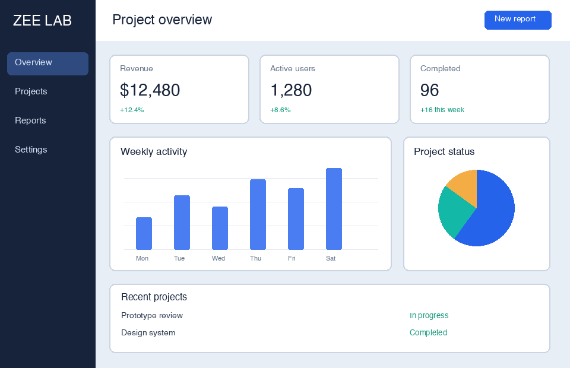

# zee-rp

**把截图、JSON 和 RP/1 源码变成可在 Axure 中继续编辑的原型。通过 CLI 或 MCP 直接读取、修改原生 `.rp`。**

[English](README.md) · [图片转原型](references/screenshot-workflow.md) · [RP/1](references/rp-language.md) · [能力边界](references/capabilities.md)

https://github.com/user-attachments/assets/39c37462-3956-48b8-b495-fe90d2ab9431

**从一句话，到可编辑原型**：以原创「知序」考研复习 App 为案例，使用 huashu-motion 制作的 40 秒宣传片，1080p、60 fps，含配乐与音效。[下载 MP4](https://github.com/LilZeeCN/zee-rp/releases/download/v0.2.1/zee-rp-zhixu-1080p60.mp4) · [案例与素材说明](assets/promo/README.md)

画面按案例规格重建，是工作流动效演示；不是软件录屏，剪辑时间不代表原型生成耗时。



## 包含什么

- **图片转原型**：OCR、布局与几何识别、图文分离、图表还原、背景分层、自动成稿、批量改字和视觉差分。
- **RP/1 原型语言**：JSON / 文本语法、布局、主题、组件、原生输入、动态面板、中继器、数据、表达式、交互、规则，以及有限母版和自适应支持。
- **原生文件读写**：文字、富文本、页、交互、表格、连接线、面板、中继器和母版；包含 RP9/RP11 版本适配。
- **已有全局样式维护**：级联改名和批量绑定，覆盖页面、母版与面板状态的名称引用和缓存；采用 Axure 先建样式、脚本再绑定的[混合流程](references/custom-styles.md)。
- **验证工具**：参考模拟、本机 Axure 表达式检查、真实预览重放、反例缩减和 GUI 证据检查。
- Node、Python、Swift、CLI、MCP、Agent Skill、示例和配套测试完整提供。

这是独立实验性项目。近期 RP/1 原生行为的证据限具体 macOS + Axure RP9 样本，不代表所有功能、版本和平台均通过。[验证说明](docs/verification.md)记录实际边界。

## 安装

需要 Node.js 18+、Python 3.10+。截图 OCR 使用 macOS Vision 和 Swift 编译器；生成原生 `.rp` 需要本机 Axure，以及用对应版本自行保存的单页空白工程。

```sh
git clone https://github.com/LilZeeCN/zee-rp.git
cd zee-rp
python3 -m venv .venv
source .venv/bin/activate
python -m pip install -r requirements.txt
npm ci
```

执行 Node 命令时保持 Python 虚拟环境已激活，工具会从 `PATH` 调用 `python3`。底层 Node 文件引擎没有必需的 npm 运行时依赖；MCP 使用可选 SDK，视觉能力另需上述 Python 包。

## 图片转可编辑布局

```sh
node scripts/trace.mjs draft examples/screenshot/source.png -o outputs/screenshot --scale 1 --axvg outputs/screenshot/page.axvg.json
```

输出规格、剪贴板 JSON 和视觉对比图。真正的 `.rp` 需进入 Axure 粘贴并保存。RP9 中先打开一个新工作工程，再执行：

```sh
python3 tools/rp9_place.py /绝对路径/新工作工程.rp --axvg outputs/screenshot/page.axvg.json
```

这个 GUI 工具会清空指定工作工程的当前页，请使用新工程。RP11 使用 `node scripts/axvg.mjs paste outputs/screenshot/page.axvg.json --version 11`，随后在 Axure 保存。

文字和已支持的几何会变成原生元件；照片、复杂画面和部分图标仍是独立图片。静态截图不能恢复原站点全部业务逻辑。[完整流程及指标含义](references/screenshot-workflow.md)。

## RP/1 生成原生工程

先用 RP9 保存一个单页空白工程，再指定它：

```sh
export AXURE_BLANK_TEMPLATE_RP9=/绝对路径/自己的RP9空白工程.rp
node scripts/proto.mjs check --spec examples/rp-language/counter.json
node scripts/proto.mjs generate --spec examples/rp-language/counter.json --out-dir outputs/counter --out-rp outputs/counter/counter.rp
```

数据业务示例见 `examples/rp-language/runtime-inventory.json`。输出必须使用新文件名。原生模板、元件库和官方运行时均从用户本机读取，不随项目分发。

使用 MCP 时，直接调用 `generate_prototype({spec: RP1规格对象, output: "/绝对路径/新原型.rp"})`，即可一次完成多页生成、跨页传值/跳转和结构检查，返回文件路径、页面标识与检查摘要，无需手工装配。共享主题、色板和组件仍在规格中声明。见[调用示例与错误格式](references/mcp-prototype.md)及[三页案例](examples/rp-language/mcp-three-pages.json)。

节点的 `name` 直接作为 Axure OUTLINE 显示名，支持中文和重名；引用继续用 `id`。已有工程只改名字可直接执行：

```sh
node bin/axure.mjs name-widget 原工程.rp 改名后.rp --name "旧名称" --to "搜索输入框"
```

MCP 打开工程后调用 `rename_widget({target: {name: "旧名称"}, name: "搜索输入框"})` 即可；`edits` 支持一次批量修改。遇到重名时用返回候选的 `record` + `id` 精确指定。名称重复会在读取摘要中提示，不作为文件损坏；按名称编辑仍要求唯一目标。

## CLI、MCP 和测试

```sh
node bin/axure.mjs --help
node bin/axure.mjs rp-read /绝对路径/工程.rp --json
node bin/mcp.mjs
npm test
npm run test:language
npm run test:runtime
npm run test:trace
node scripts/pack-release.mjs -o /绝对路径/新的源码目录
```

MCP 客户端设置 `command: "node"`、`args: ["/绝对路径/zee-rp/bin/mcp.mjs"]`，并按版本传入模板环境变量。Agent 使用 [SKILL.md](SKILL.md)，低层命令见[命令表](references/commands-generated.md)。

`npm test` 不要求安装 Axure。其它测试的前提见 [CONTRIBUTING.md](CONTRIBUTING.md)。结构、模拟、实际预览、GUI 修改和保存重开分别记录。

截图演示、手机外框与图标由 [generate-assets.py](examples/generate-assets.py) 使用原创几何生成，不含第三方页面截图、官方文件、模板或系统字体。源码和自制示例采用 [MIT](LICENSE)。
