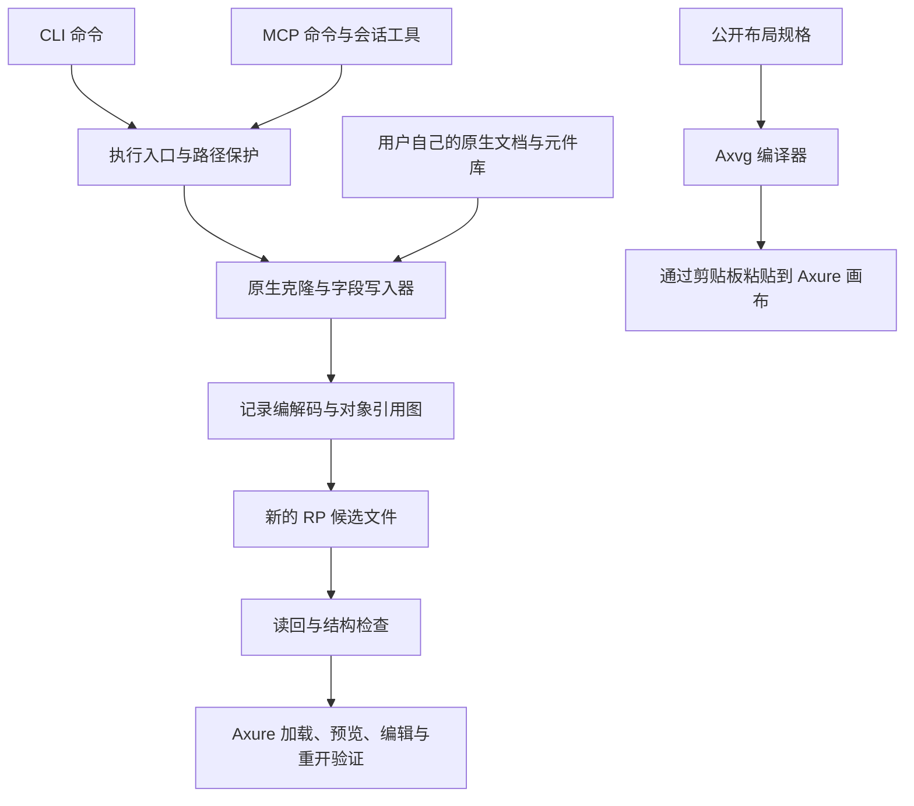

# zee-rp

[English](README.md) · [完整命令表](references/commands-generated.md) · [能力边界](references/capabilities.md) · [验证流程](docs/validation.md)

**通过脚本或 AI 助手读取、检查和编辑受支持的 Axure RP 11 原型。**

zee-rp 是独立的原生 `.rp` 文档工具集，采用 MIT 许可证。它包含二进制记录编解码、对象引用处理、原生模板克隆、交互写入器、富文本、表格，以及可选的 Model Context Protocol（MCP）服务。公开接口提供 **31 条 CLI 命令和 43 个 MCP 工具**。

你可以用它理解已有原型、执行可重复的修改、基于自己的原生模板构建项目，或让 MCP 客户端按“检查—修改—验证”的顺序完成多步编辑。原生文档流程直接读取和写入 `.rp` 文件；独立的 Axvg 流程则将布局规格编译为可粘贴到 Axure 画布的内容。

仓库公开了源码、schema、测试运行器、测试合同与指纹、文档生成器、发布打包器，以及可复现的示例生成方法。原生模板和元件库由使用者从自己的 Axure 安装环境提供。各项操作的支持范围和证据分别记录，工具不保证任意文档、元件或交互都能处理。

https://github.com/user-attachments/assets/48d47444-b863-4e01-ad01-49ac0d8d312c

> **▶ 项目宣传片（32 秒）：** 可直接在上方播放器内点击播放，或下载 [1080p 无损母片 MP4（`CRF=18`，60 MB）](https://github.com/LilZeeCN/zee-rp/releases/download/v0.1.1/zee-rp-intro.mp4) · [仓库内文件 (`assets/zee-rp-intro.mp4`)](https://github.com/LilZeeCN/zee-rp/blob/main/assets/zee-rp-intro.mp4)


这是一张确定性生成的**参考图**，不是 Axure 截图，也不代表原生验收结果。它来自公开的[布局规格](assets/dashboard-example.spec.json)，图中的数量只是示意内容。下文的原生示例是另一套生成流程，产物包含五个具名元件和一个单独的表格文档。

## 目录

- [可以做什么](#可以做什么)
- [环境要求与安装](#环境要求与安装)
- [生成第一个原生示例](#生成第一个原生示例)
- [CLI 使用示例](#cli-使用示例)
- [用 Axvg 构建静态布局](#用-axvg-构建静态布局)
- [接入 MCP 客户端](#接入-mcp-客户端)
- [实现架构与源码入口](#实现架构与源码入口)
- [测试与证据](#测试与证据)
- [常见问题](#常见问题)
- [开源内容与发布](#开源内容与发布)
- [参与贡献与阅读路线](#参与贡献与阅读路线)
- [许可证与项目关系](#许可证与项目关系)

## 可以做什么

| 领域 | 常见操作 | 主要命令 |
| --- | --- | --- |
| 文档检查 | 读取页面、元件、文字、交互、变量和引用健康度 | `rp-read` |
| 工程与页面 | 复制真实空白工程、添加空白页、复制受支持的页面 | `create-blank-project`, `create-blank-page`, `duplicate-page` |
| 原生元件 | 从本机元件库克隆元件或页面内容，为元件设置稳定名称 | `clone-library-widget`, `clone-library-page-content`, `name-widget` |
| 动态面板 | 克隆面板、填充或清空状态、配置适应内容 | `create-panel-clone`, `fill-panel-state`, `remove-panel-state-content`, `set-panel-fit-to-content` |
| 母版 | 克隆原生母版定义、放置实例、应用受支持的覆盖值 | `create-master`, `place-master`, `set-master-overrides` |
| 文字与控件 | 修改文字、富文本片段、表格内容、组合框和列表框选项 | `set-widget-text`, `set-widget-richtext`, `set-native-table`, `set-combobox-options`, `set-listbox-options` |
| 交互 | 添加或移除事件与动作、设置元件链接、创建全局变量 | `add-interaction`, `remove-interaction`, `add-click-link`, `create-global-variable` |
| 连接线与响应式布局 | 克隆受支持的原生连接线、修改锚点、添加自适应视图 | `clone-native-connector`, `set-connector-anchors`, `add-adaptive-view` |
| 静态画布内容 | 编译公开布局规格，并粘贴到 Axure 画布 | `axvg build`, `axvg paste`, `axvg selftest` |
| 定向研究修改 | 修改受支持的字符串或链接窗口字段 | `patch-string`, `patch-link-window` |

准确的参数顺序、目标选择方式和选项见[生成的命令表](references/commands-generated.md)。上表方便查找入口，不表示所有命令都有同等程度的原生验收。

实现以真实原生结构为基础。克隆元件或容器时，会复制必需的对象引用闭包并重新映射身份。交互写入遵循已登记的动作与表达式合同；不支持的形式会被拒绝，不会靠猜测写入。

目前的主要边界包括：

- 编解码器面向受支持的压缩 RP 11 输入，不支持写入未压缩 manifest。
- 原生克隆需要自己的文档或元件库中存在兼容源对象。不支持的外部引用、动作或容器作用域可能被拒绝。
- 富文本支持文档列出的样式、链接、段落和列表级别字段；尚未提供有序列表和真正的原生合并单元格。表格视觉合并通过覆盖层实现。
- 母版覆盖支持特定 Text/Image 值。中继器和自适应视图支持限定于已有文档记录的样例与表达式形式。
- 表达式函数调用遵循已登记的合同。未知函数，以及 `Concat` FCall 等不支持的形式会被拒绝。
- 最近的写入器改动有离线验证；原生加载、预览行为和 GUI 编辑仍需分别验收。

为不同于示例的文档选择操作路线前，请先阅读[能力边界](references/capabilities.md)。

## 环境要求与安装

### 按使用方式准备环境

| 使用方式 | 所需条件 |
| --- | --- |
| 公开源码检查与 Axvg 编译 | Node.js 18 或更新版本，无需安装 Axure |
| 读取已有原生文档 | Node.js 和受支持的 `.rp` 输入 |
| 生成原生示例 | 用户保存的空白 `.rp` 和本机 `Default.rplib` |
| MCP 服务 | Node.js，以及通过 `npm ci` 安装的依赖 |
| 原生加载、预览和编辑验收 | 用户自己的 Axure RP 安装 |
| Axvg 剪贴板粘贴 | 受支持的 macOS/Windows 剪贴板环境，以及已打开的 Axure 画布 |
| 原生 GUI 任务 | macOS、Axure 和辅助功能权限 |

已记录的原生验收环境为 **macOS / Axure RP 11.0.0.4137**。公开核心检查也在 Linux CI 中运行。其他 Axure build、元件库布局、操作系统和文档变体需要单独验证。

### 获取源码

```sh
git clone https://github.com/LilZeeCN/zee-rp.git
cd zee-rp
node bin/axure.mjs --help
npm test
```

核心 CLI 和默认公开测试无需安装额外依赖包。使用 MCP 时再安装依赖：

```sh
npm ci
```

包定义了 `zee-rp` 和 `zee-rp-mcp` 可执行入口。本文直接使用 `node bin/axure.mjs` 和 `node bin/mcp.mjs`，因此在克隆后的仓库中即可运行，无需全局安装。

### 准备原生输入

在 Axure RP 11 中创建只有一页的空白工程，将页名设为 `Page 1`，保存为模板。工具在复制前会验证它确实为空白。示例使用本机默认元件库中的英文页面名称。

先创建输出目录，再配置绝对路径：

```sh
export AXURE_BLANK_TEMPLATE="/absolute/path/blank.rp"
export AXURE_LIBRARY_ROOT="/absolute/path/DefaultSettings/Libraries"
export AXURE_WRITE_ROOT="/absolute/path/outputs"
```

如果安装位置与默认 macOS 路径一致，可以省略 `AXURE_LIBRARY_ROOT`。未设置 `AXURE_BLANK_TEMPLATE` 时，默认查找 `~/Library/Application Support/zee-rp/templates/axure-rp11-blank.rp`；这个文件仍需由你提供。

`AXURE_WRITE_ROOT` 用于可选的输出范围限制。统一 CLI/MCP 入口会检查输出是否位于允许范围内，也可以通过 `AXURE_PROTECTED_PATHS` 拒绝访问指定的输入或输出路径。在已经验证的 macOS/POSIX 路径方式下，这两个变量均可用冒号分隔多个条目。直接调用底层库不会获得同等的入口保护。全部变量见[环境配置说明](docs/validation.md#environment)。

原生 `.rp` 写入器只创建新输出文件，已有目标会被拒绝。每一步使用新的文件名。MCP 会话在源文件旁创建工作副本，因此源文件所在目录也必须可写。

## 生成第一个原生示例

在仓库根目录运行以下生成方法。目标目录应当是允许写入范围内一个尚不存在的新目录：

```sh
node examples/build-native-demo.mjs /absolute/path/outputs/demo
node bin/axure.mjs rp-read /absolute/path/outputs/demo/5-widget.rp --json
```

生成器复制你的空白模板，从本机 `Default.rplib` 导入原生对象，并在 `demo.json` 中记录输出。它不依赖维护者的私人研究样本。

| 输出 | 内容 |
| --- | --- |
| `00-blank.rp` | 已验证的空白工程副本 |
| `1-widget.rp` 至 `5-widget.rp` | 依次添加原生元件的各步产物 |
| `5-widget.rp` | `SubmitButton`、`StatusBanner`、`NameInput`、`AnchorA` 和 `AnchorB` |
| `table.rp` | 从本机元件库克隆的原生经典表格内容 |
| `demo.json` | 页面名称、输出文件名、元件名称和证据范围 |

最终元件文件与表格文件是两个独立文档，后面的例子分别使用它们作为输入。如果空白页名称不同，需要修改命令中的页名，并先复制 JSON 示例再调整其中的页名。

生成或修改候选文件后，先读回文件，检查结构诊断。再在 Axure 中打开该候选，验证任务所需的原生行为。成功写入、健康解析、预览正确和保存后仍可编辑，分别说明不同层面的事实。

## CLI 使用示例

以下示例均从仓库根目录运行。每个例子使用明确的输入，并写入不同的新输出，可以独立尝试。需要连续修改时，将上一条命令的输出作为下一条命令的源文件。

### 修改前先检查

```sh
node bin/axure.mjs rp-read /absolute/path/outputs/demo/5-widget.rp
node bin/axure.mjs rp-read /absolute/path/outputs/demo/5-widget.rp --json
node bin/axure.mjs rp-read /absolute/path/outputs/demo/5-widget.rp --json --full
```

通过摘要确认实际页面和元件名称、容器位置，以及已有交互。JSON 输出便于自动检查；`--full` 请求展开读取结果。结构健康度包含 `unparseable`、`danglingRefs` 和 `problems`，受支持的健康候选应当三项均为零。

### 修改元件的普通文字

```sh
node bin/axure.mjs set-widget-text \
  /absolute/path/outputs/demo/5-widget.rp \
  /absolute/path/outputs/text.rp \
  "Page 1" "SubmitButton" "Confirm & Proceed"
```

按名称定位时，必须能确定目标元件。对于嵌套元件或重名目标，先检查文档，再使用命令文档中的显式定位选项，或 MCP 的 `locate` 结果。外观相似的标签不能代替可靠的对象身份。

### 写入带内联链接的富文本

仓库中的[富文本示例](examples/richtext.json) 采用以下结构：

```json
{
  "page": "Page 1",
  "widget": "StatusBanner",
  "paragraphs": [{
    "list": true,
    "lineSpacing": 72,
    "runs": [
      {"text": "Notice: ", "style": {"bold": true, "size": 16}},
      {
        "text": "Documentation",
        "style": {"color": "#2563EB"},
        "link": {"url": "https://example.com", "window": "new"}
      }
    ]
  }]
}
```

```sh
node bin/axure.mjs set-widget-richtext \
  /absolute/path/outputs/demo/5-widget.rp \
  /absolute/path/outputs/rich.rp \
  examples/richtext.json
```

传入包含 `paragraphs[].runs[]` 的 JSON **文件**。字号使用 `style.size`，`link` 与 `style` 并列。支持的链接目标为已有页面或 HTTP(S) URL，窗口方式为 `current` 或 `new`。段落 `lineSpacing` 是原生字段，其数值不保证等于 CSS 像素行高。写入器会校验受支持的样式键和值。

### 填充原生表格

[表格示例](examples/table.json) 的 `cells` 支持普通字符串和富文本片段对象，同时可指定行高与列宽：

```json
{
  "cells": [
    [
      {"runs": [
        {"text": "H ", "style": {"bold": true}},
        {"text": "1", "style": {"color": "#2563EB"}}
      ]},
      "Value"
    ],
    ["Sample", "42"]
  ],
  "columnWidths": [180, 100],
  "rowHeights": [36, 36]
}
```

```sh
node bin/axure.mjs set-native-table \
  /absolute/path/outputs/demo/table.rp \
  /absolute/path/outputs/table.rp \
  examples/table.json
```

此操作修改受支持的原生表格内容。视觉合并及其他限制见能力说明。

### 添加变量或复制页面

```sh
node bin/axure.mjs create-global-variable \
  /absolute/path/outputs/demo/5-widget.rp \
  /absolute/path/outputs/variable.rp \
  Counter --default-value "7"

node bin/axure.mjs duplicate-page \
  /absolute/path/outputs/demo/5-widget.rp \
  /absolute/path/outputs/pages.rp \
  "Page 1" "Page Copy"
```

变量写入器创建具名全局变量并设置默认值。页面复制会重新映射受支持的原生身份和引用；任意不支持的动作或容器形式不属于该操作的合同范围。

### 添加交互

以下命令为示例按钮添加点击事件，并执行一个短暂等待动作：

```sh
node bin/axure.mjs add-interaction \
  /absolute/path/outputs/demo/5-widget.rp \
  /absolute/path/outputs/click.rp \
  SubmitButton --on-page "Page 1" \
  --event OnClick --action wait ms=100
```

对于你自己的文档，如果已有 `Home` 页面、`OpenMenuBtn` 元件、`MenuPanel` 面板和 `Expanded` 状态，可以使用：

```sh
node bin/axure.mjs add-interaction \
  /absolute/path/source-with-panel.rp \
  /absolute/path/outputs/panel-click.rp \
  OpenMenuBtn --on-page "Home" \
  --event OnClick --action set-panel-state target=MenuPanel state=Expanded
```

`--on-page` 将元件搜索限制在指定页面；`--page` 则选择页面级事件目标。`--replace-event` 替换该目标上唯一匹配的同类型已有事件。条件、多 Case 和多动作通过文档规定的 `--json` 规格与已登记的表达式形式构造。修改前先检查已有交互，修改后在预览中验证实际效果。

## 用 Axvg 构建静态布局

Axvg 走“规格—编译—剪贴板”的路线。输入描述画布区域和受支持的视觉对象，不直接生成原生 `.rp` 文件。

```sh
node bin/axure.mjs axvg build \
  assets/dashboard-example.spec.json \
  -o /absolute/path/outputs/demo.axvg.json

node bin/axure.mjs axvg selftest
```

在受支持的剪贴板平台上打开 Axure 画布后，运行：

```sh
node bin/axure.mjs axvg paste /absolute/path/outputs/demo.axvg.json
```

在 Axure 中检查粘贴结果并保存。画布粘贴与原生文档写入器是不同的流程，编译成功的 Axvg JSON 不等于通过原生验收。

公开的参考 SVG 可以单独重新生成：

```sh
node examples/render-layout.mjs \
  assets/dashboard-example.spec.json \
  /absolute/path/outputs/demo-layout.svg
```

各输入路线及其限制见 [Axvg 格式](references/axvg-format.md)、[HTML 工作流](references/html-workflow.md) 和[截图工作流](references/screenshot-workflow.md)。

## 接入 MCP 客户端

可选 MCP 服务公开命令注册表，并增加文档会话和 GUI/任务工具。先运行 `npm ci` 安装依赖，再在支持本地 stdio MCP 的客户端中添加服务：

```json
{
  "mcpServers": {
    "zee-rp": {
      "command": "node",
      "args": ["/absolute/path/to/zee-rp/bin/mcp.mjs"],
      "env": {
        "AXURE_BLANK_TEMPLATE": "/absolute/path/blank.rp",
        "AXURE_LIBRARY_ROOT": "/absolute/path/DefaultSettings/Libraries",
        "AXURE_WRITE_ROOT": "/absolute/path/outputs"
      }
    }
  }
}
```

各客户端的配置外层结构可能不同。使用入口脚本的绝对路径，并确保客户端能够找到 Node.js。服务通过 stdio 进行 MCP 通信，请通过客户端发现和调用工具。

### 工具分组

| 分组 | 数量 | 用途 |
| --- | --- | --- |
| 命令工具 | 31 | 对应 CLI 注册表，例如 `rp_read`、`set_widget_text` 和 `axvg_build` |
| 会话工具 | 8 | `axure_open`、`axure_state`、`locate`、`inspect`、`read_interactions`、`edit_text`、`verify`、`axure_save` |
| GUI/任务工具 | 4 | `gui_roundtrip`、`jobs_list`、`jobs_get`、`jobs_cancel` |

多数命令工具接受原始 `args` 数组，部分工具也提供具名字段。以客户端发现的输入 schema 为准。同一次调用不要混用具名字段与原始参数形式。

### 从检查到另存的完整会话

以下 JSON 是传给相应 MCP 工具的**调用参数**。使用前面生成的原生示例，以保证页名和元件名称一致。

1. 调用 `axure_open`：

   ```json
   {"path": "/absolute/path/outputs/demo/5-widget.rp"}
   ```

2. 调用 `locate`：

   ```json
   {"query": "SubmitButton", "page": "Page 1", "limit": 20}
   ```

3. 对唯一目标依次调用 `inspect` 和 `edit_text`：

   ```json
   {"target": {"name": "SubmitButton", "page": "Page 1"}}
   ```

   ```json
   {
     "target": {"name": "SubmitButton", "page": "Page 1"},
     "text": "Confirm & Proceed"
   }
   ```

4. 调用 `verify`：

   ```json
   {"deep": true}
   ```

5. 调用 `axure_save`，使用新的输出路径：

   ```json
   {"as": "/absolute/path/outputs/mcp-result.rp"}
   ```

`axure_open` 在源文件旁创建新的工作副本。成功的会话修改会扩展工作文件链，源文件保持原样。新节点必须通过结构检查，才能成为链尾。被拒绝的候选可能以 `.rejected` 后缀保留，之前已通过的链尾继续有效。

名称不唯一时，使用 `locate` 返回的 `record` 和 `id`，必要时再带上 `container`。这些定位信息对应当前文档状态；改变目标结构后，应重新定位。修改交互前调用 `read_interactions` 查看现状。`axure_state` 返回当前文件链和操作时间线；`verify` 从磁盘重新读取链尾。

### 会话中的富文本与命令调用

需要样式段落时，调用 `edit_text`，以 `richRuns` 代替 `text`：

```json
{
  "target": {"name": "StatusBanner", "page": "Page 1"},
  "richRuns": [{
    "list": true,
    "lineSpacing": 72,
    "runs": [{
      "text": "Documentation",
      "style": {"color": "#2563EB"},
      "link": {"url": "https://example.com", "window": "new"}
    }]
  }]
}
```

`edit_text` 还接受 `edits` 数组进行批量修改；全部修改成功后，整批才会推进文件链。

部分具名命令工具在同时省略宿主源文件和输出路径时，会使用当前会话。例如调用 `create_global_variable`：

```json
{"name": "Counter", "defaultValue": "7"}
```

原始参数形式需要 `session:true`，并省略宿主源文件与输出参数。例如调用 `set_widget_text`：

```json
{
  "session": true,
  "args": ["Page 1", "SubmitButton", "Continue"]
}
```

显式传入源文件和输出路径时，只操作这些文件，不推进会话链。多源导入工具仍需传入外部导入源。每个服务进程维护自己的活动会话；再次调用 `axure_open` 会替换该进程的活动会话。

### 原生 GUI 任务

`gui_roundtrip` 和任务工具提供 macOS 原生往返验证路线，需要 Axure 和辅助功能权限。模拟任务测试只验证编排逻辑。发布记录中的真实 GUI 样本验证了新副本的加载、保存、关闭和重开，没有测试预览行为或手动 GUI 编辑。使用前请阅读[发布证据](docs/release-evidence.json) 和客户端发现的工具 schema。

## 实现架构与源码入口



记录编解码器负责读取和重建原生记录；payload 解析器表示带类型的字段和对象引用。闭包克隆收集受支持的依赖，重新映射身份，并检查容器作用域。写入器随后修改特定的受支持字段或动作树。CLI/MCP 层在这些基础能力之上提供目标处理、路径限制和会话行为。

| 路径 | 职责 |
| --- | --- |
| [bin/axure.mjs](bin/axure.mjs) | 统一 CLI 入口 |
| [bin/mcp.mjs](bin/mcp.mjs) | 可选 stdio MCP 服务 |
| [scripts/registry.mjs](scripts/registry.mjs) | 已登记命令、用法、工具和 schema 绑定 |
| [scripts/engine.mjs](scripts/engine.mjs) | CLI 分发与路径保护 |
| [scripts/rp-records.mjs](scripts/rp-records.mjs) / [scripts/parse-payload.mjs](scripts/parse-payload.mjs) | 二进制记录和带类型的 payload 解析/编码 |
| [scripts/clone-closure.mjs](scripts/clone-closure.mjs) | 原生对象闭包与身份重映射 |
| [scripts/ix-actions.mjs](scripts/ix-actions.mjs) | 交互构造与已登记的表达式合同 |
| [scripts/mcp-tools.mjs](scripts/mcp-tools.mjs) | MCP schema、命令分发和会话 |
| [scripts/jobs.mjs](scripts/jobs.mjs) / [scripts/gui-roundtrip.swift](scripts/gui-roundtrip.swift) | 任务生命周期与原生 macOS 辅助程序 |
| [examples/build-native-demo.mjs](examples/build-native-demo.mjs) | 公开原生示例生成方法 |
| [test/regression.mjs](test/regression.mjs) | 无需原生输入的公开检查 |
| [test/native-check.mjs](test/native-check.mjs) / [test/mcp-check.mjs](test/mcp-check.mjs) | 生成样例的原生检查与真实 stdio 检查 |
| [scripts/pack-release.mjs](scripts/pack-release.mjs) | 完整公开发布文件选择与 SHA-256 清单 |

新贡献者或 AI 助手可以先读本文，再读[能力边界](references/capabilities.md) 和[命令表](references/commands-generated.md)。修改写入器前，阅读对应工作流参考。准确合同以实现和测试为依据；历史记录解释特定旧样本，不代表对任意输入的保证。

## 测试与证据

### 公开检查

```sh
npm test
```

默认运行器检查源码语法、命令登记、MCP schema、Axvg 确定性编译、参考图生成、文档文件链接、样式校验、路径保护、发布完整性和源码指纹，无需 Axure 或私人样本。

### 生成样例的原生与 MCP 检查

配置好空白模板和默认元件库后，运行：

```sh
npm run test:native
npm ci
npm run test:mcp
```

这些测试通过公开生成方法构造新的原生输入，检查实际 CLI/MCP 写入、语义字段，以及真实 SDK/stdio 调用，不需要精确的历史样本包。原生测试使用临时输出目录，运行时应取消 `AXURE_WRITE_ROOT`，或将系统临时目录加入允许范围。

| 命令 | 所需输入 | v0.1.1 已记录结果 | 证据范围 |
| --- | --- | --- | --- |
| `npm test` | 仅 Node.js | 16/16 | 公开源码、合同、打包和离线检查 |
| `npm run test:native` | 本机空白模板与 `Default.rplib` | 10/10 | 生成样例的原生结构与语义 |
| `npm run test:mcp` | 同上，并已安装 SDK | 6/6 | 生成输入经真实 stdio MCP 调用 |
| `npm run test:parity` | 具有指定空白页/记录布局的模板 | 23/23 | CLI/直接脚本一致性与路径保护 |
| `npm run test:jobs` | macOS 与本机空白模板 | 11/11 | 模拟进程生命周期，不操作真实 GUI |
| `npm run test:historical` | 精确的外部历史样本包与原生运行时 | 225/225 | 历史离线断言 |
| `npm run test:historical-mcp` | 精确外部样本包与已安装 SDK | 67/67 | 历史 stdio 断言 |

上表是该版本的实际测试记录，不是功能覆盖率。历史 225/67 项不是 `npm test` 的输出。缺少前置条件会导致测试失败，不会将跳过计为通过。

### 原生验收需要逐层进行

| 层级 | 能说明什么 |
| --- | --- |
| 构造 | 命令生成了输出文件 |
| 离线结构与语义 | 记录可解析，预期字段、引用和值匹配 |
| 原生加载 | Axure 能打开候选文件 |
| 预览行为 | 实际观察到交互产生预期效果 |
| GUI 编辑与保存重开 | 目标原生对象可编辑，保存重开后仍保持正确 |

通过某一层不代表后续层也已通过。早期样本的原生记录见[历史能力说明](docs/historical-capabilities.md)，当前版本结果和未运行的验收范围见 [release-evidence.json](docs/release-evidence.json)。

精确历史输入由[样本合同](test/historical-fixture-contract.json) 和精简的[摘要指纹](test/historical-snapshots.json) 描述。原生二进制样本不随仓库分发，因此没有该样本包的外部使用者不能精确复现历史结果。公开生成方法提供另一条可复现路线。全部前置条件和环境变量见[验证说明](docs/validation.md)。

## 常见问题

| 现象 | 检查方式 |
| --- | --- |
| 空白模板校验失败 | 保存真正只有一页的空白原生工程，并检查 `AXURE_BLANK_TEMPLATE` |
| 生成器找不到元件库或源页面 | 检查 `AXURE_LIBRARY_ROOT`、`Default.rplib` 和生成方法使用的英文源页名 |
| 输出已经存在 | 更换文件名或示例目录，原生写入器会拒绝覆盖 |
| 会话无法创建工作副本 | 将源文件复制到允许写入的目录，或把源目录加入 `AXURE_WRITE_ROOT` |
| 一个目标匹配到多个元件 | 查看候选列表，按页面限制，或使用当前 `locate` 返回的记录/对象定位信息 |
| 命令拒绝动作或表达式 | 使用已登记合同和文档中的准确名称，检查对应写入器与能力边界 |
| MCP 服务连接失败 | 运行 `npm ci`，检查入口绝对路径，确认客户端能够启动 Node.js |
| 原生测试被路径限制拒绝 | 允许临时输出目录，或在该次测试中取消 `AXURE_WRITE_ROOT` |
| 文件可解析但外观或行为不正确 | 分别记录失败的原生加载、预览或编辑步骤，并附 build 和公开复现方法 |

更多工作流诊断见[故障排查参考](references/troubleshooting.md)。报告问题时，请提供命令或工具参数、Node/Axure 版本、相关结构诊断和最小公开复现方法。不要把私人用户文档当作公开复现输入。

## 开源内容与发布

| 仓库包含 | 需要外部提供 |
| --- | --- |
| 原创运行实现与 CLI/MCP 入口 | 用户自己的 `.rp` 和 `.rplib` 输入 |
| 命令注册表、schema 绑定和探针 | Axure 应用与原生运行时文件 |
| 公开测试和历史测试源码 | 精确的原生历史样本二进制文件 |
| 测试合同与精简 SHA-256 指纹 | 私人用户文档与第三方资产 |
| 文档、示例生成方法、JSON 规格和参考 SVG | 本机安装设置与会话数据 |
| 发布打包器和文档生成器 | 通过 `npm ci` 恢复的依赖 |

示例生成方法的源码已公开，原生输入保留在各使用者自己的环境中。发布工具保留原创实现、测试和文档，同时排除原生样本、厂商文件、符号链接和依赖目录。

在新的目标路径生成命令文档或发布目录：

```sh
node scripts/gen-capabilities.mjs -o /absolute/path/new-commands.md
node scripts/pack-release.mjs -o /absolute/path/new-release-directory
npm pack --dry-run
```

命令文档生成器读取注册表，不会执行测试。发布打包器按原内容复制公开文件，并写入 SHA-256 清单。发布新版本前，检查文件选择结果，并在打包后的目录运行公开检查。

带版本标签的源码快照见 [GitHub Releases](https://github.com/LilZeeCN/zee-rp/releases)，版本改动见[更新日志](CHANGELOG.md)，当前 CI 结果见 [GitHub Actions](https://github.com/LilZeeCN/zee-rp/actions)。发布证据对应其注明的版本和环境，`main` 可能包含之后的文档或实现改动。

## 参与贡献与阅读路线

修改原生写入器或 MCP 接口前，请阅读 [CONTRIBUTING.md](CONTRIBUTING.md)。保持改动范围明确，为行为变化提供公开可复现的方法，并分别报告相关验证层级。

所有改动都应运行 `npm test`。写入器改动还需要生成样例的原生检查，MCP 改动需要 stdio 测试。生产脚本均已登记并记录指纹，有意修改运行实现时，需要明确迁移源码基线。不得改写历史样本指纹来掩盖回归。

| 你的任务 | 建议入口 |
| --- | --- |
| 选择受支持的操作 | [能力边界](references/capabilities.md) 与[命令表](references/commands-generated.md) |
| 编辑原生工程 | [RP 工作流](references/rp-workflow.md) |
| 从 HTML 或截图出发 | [HTML 工作流](references/html-workflow.md) 或[截图工作流](references/screenshot-workflow.md) |
| 构建静态画布内容 | [Axvg 格式](references/axvg-format.md) |
| 处理响应式布局 | [自适应视图](references/adaptive-views.md) |
| 处理中继器模板与动作 | [中继器](references/repeaters.md) |
| 设计验收检查 | [验证说明](docs/validation.md) 与[验证工作流](references/verification.md) |
| 理解早期样本结论 | [历史能力说明](docs/historical-capabilities.md) |
| 将仓库用于 Agent 工作流 | [SKILL.md](SKILL.md)，再阅读对应参考文件 |

通过 [GitHub Issues](https://github.com/LilZeeCN/zee-rp/issues) 报告可复现的问题或提出范围明确的改进。请说明实际观察到的结果，以及失败的验收步骤。

## 许可证与项目关系

本仓库的原创代码和文档采用 [MIT 许可证](LICENSE)。

zee-rp 是独立项目，与 Axure Software Solutions, Inc. 没有隶属、赞助或背书关系。Axure RP 及相关商标属于各自权利人。MIT 许可证不授予 Axure 应用、元件库、运行时或第三方资产的许可。
